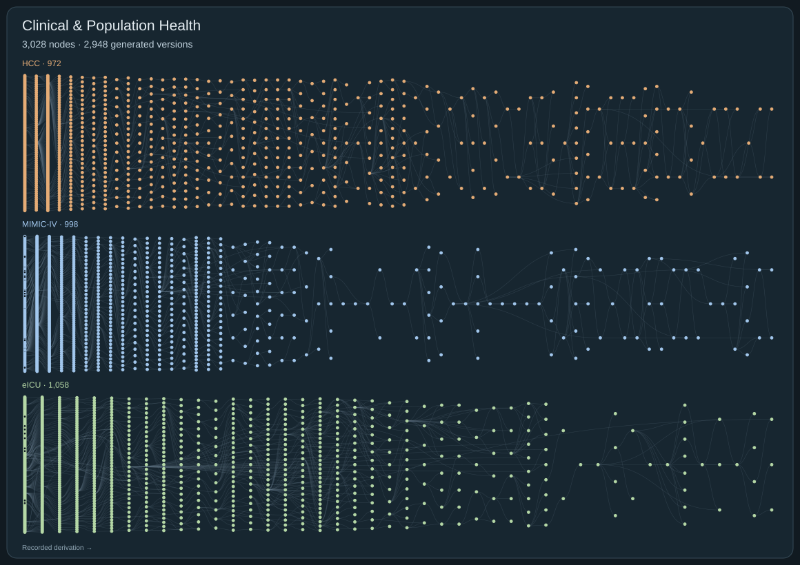

# Clinical & Population Health Research

[← Blinded review index](../REVIEW.md)

**3,045 nodes · 2,965 generated versions · 3,016 recorded parent links.**

[Open the complete tree with node IDs](../figures/01-clinical-population.svg). Download and open the SVG at native scale for readable, clickable IDs. On GitHub, use the catalogs below to open proposals and search by ID or scientific term. Hollow nodes are starting questions; filled nodes are generated versions. Every recorded parent edge is retained, including multi-parent derivations. Separate roots are not artificially joined.

## Dataset catalogs

- [HCC: 978 hypotheses and starting questions](01-clinical-population-hcc.md)

- [MIMIC-IV: 1,006 hypotheses and starting questions](01-clinical-population-mimic.md)

- [eICU: 1,061 hypotheses and starting questions](01-clinical-population-eicu.md)

