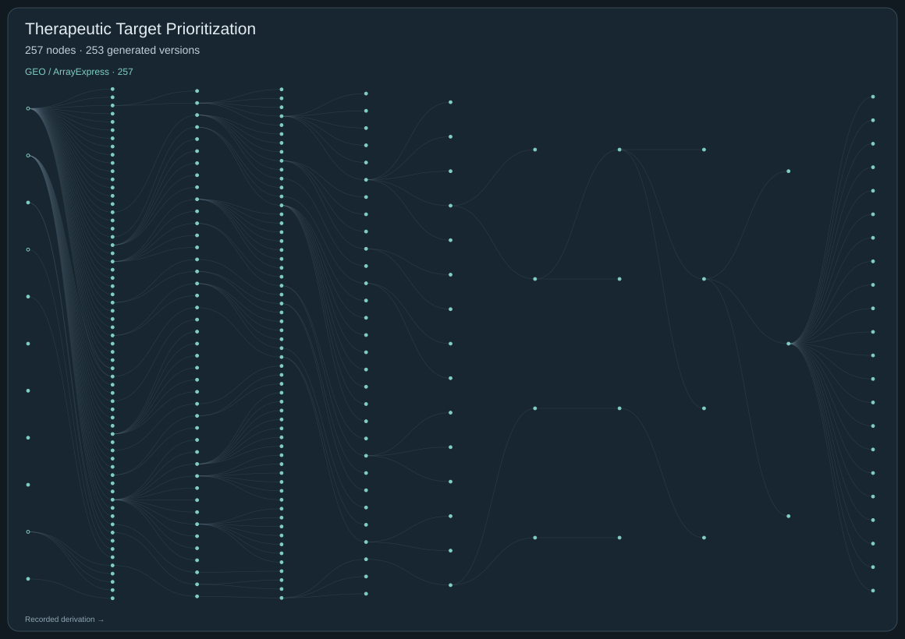

# Therapeutic Target Prioritization

[← Blinded review index](../REVIEW.md)

**262 nodes · 258 generated versions · 253 recorded parent links.**

[Open the complete tree with node IDs](../figures/02-therapeutic-targets.svg). Download and open the SVG at native scale for readable, clickable IDs. On GitHub, use the catalogs below to open proposals and search by ID or scientific term. Hollow nodes are starting questions; filled nodes are generated versions. Every recorded parent edge is retained, including multi-parent derivations. Separate roots are not artificially joined.

## GEO / ArrayExpress

262 nodes

### D2-0293C6731F · Provisional hypothesis: macrophage–fibroblast context modifies the intervention-associated fibroblast transcript response

**Full scientific proposal:** [Read the public review copy](../proposals/D2-0293C6731F.md)

**Derived from:** [D2-89AB1AC190](#d2-89ab1ac190)

**Type:** Generated hypothesis version

### D2-03E85F868B · D2-T2 evolution: donor-aware stability of the MerTK-inhibitor-associated fibroblast/macrophage pattern

**Full scientific proposal:** [Read the public review copy](../proposals/D2-03E85F868B.md)

**Derived from:** [D2-7DD6AE426C](#d2-7dd6ae426c)

**Type:** Generated hypothesis version

### D2-04F9E55343 · Provisional hypothesis: context-specific MerTK-inhibitor response in E-MTAB-8873

**Full scientific proposal:** [Read the public review copy](../proposals/D2-04F9E55343.md)

**Derived from:** [D2-81BF5F5865](#d2-81bf5f5865)

**Type:** Generated hypothesis version

### D2-051DEEED93 · Context-specific intervention response

**Full scientific proposal:** [Read the public review copy](../proposals/D2-051DEEED93.md)

**Derived from:** [D2-1927BBAC60](#d2-1927bbac60)

**Type:** Generated hypothesis version

### D2-05FB8D7F58 · Intervention-specificity test for protective-versus-pathogenic target selectivity

**Full scientific proposal:** [Read the public review copy](../proposals/D2-05FB8D7F58.md)

**Derived from:** [D2-A5F37D222B](#d2-a5f37d222b)

**Type:** Generated hypothesis version

### D2-066138D885 · Provisional hypothesis: macrophage context modifies the intervention-associated FLS transcript response

**Full scientific proposal:** [Read the public review copy](../proposals/D2-066138D885.md)

**Derived from:** [D2-0293C6731F](#d2-0293c6731f)

**Type:** Generated hypothesis version

### D2-0751210F34 · D2-T1 specificity child: exact-title feasibility boundary

**Full scientific proposal:** [Read the public review copy](../proposals/D2-0751210F34.md)

**Derived from:** [D2-A27215C584](#d2-a27215c584)

**Type:** Generated hypothesis version

### D2-078DEE7AD8 · Provisional hypothesis: macrophage context modifies the intervention-associated FLS transcript response

**Full scientific proposal:** [Read the public review copy](../proposals/D2-078DEE7AD8.md)

**Derived from:** [D2-913D8DC610](#d2-913d8dc610)

**Type:** Generated hypothesis version

### D2-097F881166 · Provisional hypothesis: macrophage context modifies the intervention-associated FLS transcript response

**Full scientific proposal:** [Read the public review copy](../proposals/D2-097F881166.md)

**Derived from:** [D2-913D8DC610](#d2-913d8dc610)

**Type:** Generated hypothesis version

### D2-09C2F22868 · Donor-aware protective-versus-pathogenic target selectivity

**Full scientific proposal:** [Read the public review copy](../proposals/D2-09C2F22868.md)

**Derived from:** [D2-24DE3D92DA](#d2-24de3d92da)

**Type:** Generated hypothesis version

### D2-0B732425A1 · Provisional hypothesis: assay-verified context-dependent intervention response

**Full scientific proposal:** [Read the public review copy](../proposals/D2-0B732425A1.md)

**Derived from:** [D2-4B0AF8FC57](#d2-4b0af8fc57)

**Type:** Generated hypothesis version

### D2-0BFDFEDA74 · Provisional hypothesis: intervention-specific separation of protective and harmful states

**Full scientific proposal:** [Read the public review copy](../proposals/D2-0BFDFEDA74.md)

**Derived from:** [D2-F62E8C6F3C](#d2-f62e8c6f3c)

**Type:** Generated hypothesis version

### D2-0CA45E1A51 · MerTK-inhibitor selectivity in RA synovial macrophage–fibroblast cocultures

**Full scientific proposal:** [Read the public review copy](../proposals/D2-0CA45E1A51.md)

**Derived from:** [D2-195C7DE527](#d2-195c7de527)

**Type:** Generated hypothesis version

### D2-0E4649F1E0 · Provisional hypothesis: context-dependent intervention response

**Full scientific proposal:** [Read the public review copy](../proposals/D2-0E4649F1E0.md)

**Derived from:** [D2-E9C6952ACD](#d2-e9c6952acd)

**Type:** Generated hypothesis version

### D2-0E840BBCCF · context-specific MerTK-inhibitor response in E-MTAB-8873

**Full scientific proposal:** [Read the public review copy](../proposals/D2-0E840BBCCF.md)

**Derived from:** [D2-EB5DA97D56](#d2-eb5da97d56)

**Type:** Generated hypothesis version

### D2-13C6A5A64C · Provisional hypothesis: MerTK-inhibitor response is context-specific, not a generic donor or treatment artifact

**Full scientific proposal:** [Read the public review copy](../proposals/D2-13C6A5A64C.md)

**Derived from:** [D2-702B3CCD33](#d2-702b3ccd33)

**Type:** Generated hypothesis version

### D2-145A4673E7 · MerTK remission signal: cell state or macrophage-state composition?

**Full scientific proposal:** [Read the public review copy](../proposals/D2-145A4673E7.md)

**Derived from:** [D2-E38C911CE3](#d2-e38c911ce3)

**Type:** Generated hypothesis version

### D2-14FA116D15 · Donor-aware protective-versus-pathogenic target selectivity

**Full scientific proposal:** [Read the public review copy](../proposals/D2-14FA116D15.md)

**Derived from:** [D2-4C02681571](#d2-4c02681571)

**Type:** Generated hypothesis version

### D2-15FB910541 · Donor-aware protective-versus-pathogenic target selectivity

**Full scientific proposal:** [Read the public review copy](../proposals/D2-15FB910541.md)

**Derived from:** [D2-D1DD269D2E](#d2-d1dd269d2e)

**Type:** Generated hypothesis version

### D2-164C72549B · D2-T1: Context-specific intervention response in macrophage–fibroblast coculture

**Full scientific proposal:** [Read the public review copy](../proposals/D2-164C72549B.md)

**Derived from:** [D2-1927BBAC60](#d2-1927bbac60)

**Type:** Generated hypothesis version

### D2-16EB1645A9 · Provisional rival-aware hypothesis: context-specific MerTK-inhibitor response in E-MTAB-8873

**Full scientific proposal:** [Read the public review copy](../proposals/D2-16EB1645A9.md)

**Derived from:** [D2-81BF5F5865](#d2-81bf5f5865)

**Type:** Generated hypothesis version

### D2-1724BBCD62 · MerTK remission signal: cell state or macrophage-state composition?

**Full scientific proposal:** [Read the public review copy](../proposals/D2-1724BBCD62.md)

**Derived from:** [D2-E38C911CE3](#d2-e38c911ce3)

**Type:** Generated hypothesis version

### D2-17F3A01D52 · Is the MerTK/CD206pos macrophage brake on the RA FLS effector program effector-SPECIFIC and graded, or a global composition/technical artifact? A per-FLS-cell specificity-controlled test (E-MTAB-8873)

**Full scientific proposal:** [Read the public review copy](../proposals/D2-17F3A01D52.md)

**Derived from:** [D2-F90CF0C525](#d2-f90cf0c525)

**Type:** Generated hypothesis version

### D2-1927BBAC60 · Context-specific intervention response

**Full scientific proposal:** [Read the public review copy](../proposals/D2-1927BBAC60.md)

**Derived from:** — (recorded root)

**Type:** Starting question

### D2-1936FA6AE4 · Provisional hypothesis: context-dependent intervention response

**Full scientific proposal:** [Read the public review copy](../proposals/D2-1936FA6AE4.md)

**Derived from:** [D2-1927BBAC60](#d2-1927bbac60)

**Type:** Generated hypothesis version

### D2-195C7DE527 · Protective versus pathogenic states

**Full scientific proposal:** [Read the public review copy](../proposals/D2-195C7DE527.md)

**Derived from:** — (recorded root)

**Type:** Starting question

### D2-1A3C40F353 · Episode 18 working proposal: within-assay context-by-intervention repair

**Full scientific proposal:** [Read the public review copy](../proposals/D2-1A3C40F353.md)

**Derived from:** [D2-F083B6C3F5](#d2-f083b6c3f5)

**Type:** Generated hypothesis version

### D2-1A6DC0D38A · Provisional hypothesis: macrophage–fibroblast context modifies the intervention-associated fibroblast transcript response

**Full scientific proposal:** [Read the public review copy](../proposals/D2-1A6DC0D38A.md)

**Derived from:** [D2-89AB1AC190](#d2-89ab1ac190)

**Type:** Generated hypothesis version

### D2-1ADF4E2182 · Does remission-macrophage "protection" of RA fibroblasts buy inflammatory and protease restraint at the price of a matrix-depositing fibroblast program — and are the two separable?

**Full scientific proposal:** [Read the public review copy](../proposals/D2-1ADF4E2182.md)

**Derived from:** [D2-195C7DE527](#d2-195c7de527), [D2-1927BBAC60](#d2-1927bbac60)

**Type:** Generated hypothesis version

### D2-1B2C229A54 · Donor-aware protective-versus-pathogenic target selectivity

**Full scientific proposal:** [Read the public review copy](../proposals/D2-1B2C229A54.md)

**Derived from:** [D2-4C02681571](#d2-4c02681571)

**Type:** Generated hypothesis version

### D2-1B68332782 · Context-specific MerTK blockade: does it selectively release a pathogenic FLS program?

**Full scientific proposal:** [Read the public review copy](../proposals/D2-1B68332782.md)

**Derived from:** [D2-1927BBAC60](#d2-1927bbac60)

**Type:** Generated hypothesis version

### D2-1BA1E10467 · Context-dependent fibroblast response to macrophage conditioning

**Full scientific proposal:** [Read the public review copy](../proposals/D2-1BA1E10467.md)

**Derived from:** [D2-7CF7FED2EE](#d2-7cf7fed2ee)

**Type:** Generated hypothesis version

### D2-1D26FF197C · Provisional rival-focused hypothesis (D2-T1)

**Full scientific proposal:** [Read the public review copy](../proposals/D2-1D26FF197C.md)

**Derived from:** [D2-0293C6731F](#d2-0293c6731f)

**Type:** Generated hypothesis version

### D2-1E4FDEFD2E · D2-T1: Intervention-associated transcript response in macrophage–fibroblast context

**Full scientific proposal:** [Read the public review copy](../proposals/D2-1E4FDEFD2E.md)

**Derived from:** [D2-E695A41E07](#d2-e695a41e07)

**Type:** Generated hypothesis version

### D2-1F9C29FC6E · Provisional hypothesis: macrophage–fibroblast context modifies the intervention-associated FLS transcript response

**Full scientific proposal:** [Read the public review copy](../proposals/D2-1F9C29FC6E.md)

**Derived from:** [D2-4A197D80D9](#d2-4a197d80d9)

**Type:** Generated hypothesis version

### D2-202C797BEA · A partially distinct macrophage transcriptional program in treatment-resistant rheumatoid arthritis: a donor-aware contrast on E-MTAB-8322

**Full scientific proposal:** [Read the public review copy](../proposals/D2-202C797BEA.md)

**Derived from:** — (recorded root)

**Type:** Generated hypothesis version

### D2-21F1F50F98 · Provisional hypothesis: assay-verified context-dependent intervention response

**Full scientific proposal:** [Read the public review copy](../proposals/D2-21F1F50F98.md)

**Derived from:** [D2-4B0AF8FC57](#d2-4b0af8fc57)

**Type:** Generated hypothesis version

### D2-225F874232 · Selective suppression of a pathogenic fibroblast program while preserving a protective macrophage-linked state

**Full scientific proposal:** [Read the public review copy](../proposals/D2-225F874232.md)

**Derived from:** [D2-195C7DE527](#d2-195c7de527)

**Type:** Generated hypothesis version

### D2-23637AFF8C · Provisional hypothesis: context-specific MerTK-inhibitor response in E-MTAB-8873

**Full scientific proposal:** [Read the public review copy](../proposals/D2-23637AFF8C.md)

**Derived from:** [D2-81BF5F5865](#d2-81bf5f5865)

**Type:** Generated hypothesis version

### D2-23DAF761E4 · Donor-aware protective-versus-pathogenic target selectivity

**Full scientific proposal:** [Read the public review copy](../proposals/D2-23DAF761E4.md)

**Derived from:** [D2-D1DD269D2E](#d2-d1dd269d2e)

**Type:** Generated hypothesis version

### D2-241CF25B9E · Graded, MerTK-dependent brake vs composition/state artifact: a cross-setting perturbation test on the MerTK/CD206pos macrophage -> FLS effector axis (E-MTAB-8873 + E-MTAB-8316)

**Full scientific proposal:** [Read the public review copy](../proposals/D2-241CF25B9E.md)

**Derived from:** [D2-F90CF0C525](#d2-f90cf0c525)

**Type:** Generated hypothesis version

### D2-24DE3D92DA · Donor-aware protective-versus-pathogenic target selectivity

**Full scientific proposal:** [Read the public review copy](../proposals/D2-24DE3D92DA.md)

**Derived from:** [D2-D1DD269D2E](#d2-d1dd269d2e)

**Type:** Generated hypothesis version

### D2-25E7802EA2 · Provisional hypothesis: macrophage context modifies the intervention-associated FLS transcript response

**Full scientific proposal:** [Read the public review copy](../proposals/D2-25E7802EA2.md)

**Derived from:** [D2-0293C6731F](#d2-0293c6731f)

**Type:** Generated hypothesis version

### D2-28C2BC3620 · Cell-selective MerTK perturbation in rheumatoid synovium

**Full scientific proposal:** [Read the public review copy](../proposals/D2-28C2BC3620.md)

**Derived from:** [D2-1927BBAC60](#d2-1927bbac60)

**Type:** Generated hypothesis version

### D2-291057EA78 · Context-specific intervention response: successor proposal (working)

**Full scientific proposal:** [Read the public review copy](../proposals/D2-291057EA78.md)

**Derived from:** [D2-1927BBAC60](#d2-1927bbac60)

**Type:** Generated hypothesis version

### D2-29480E0ED2 · Context-specific macrophage–fibroblast intervention response

**Full scientific proposal:** [Read the public review copy](../proposals/D2-29480E0ED2.md)

**Derived from:** [D2-1927BBAC60](#d2-1927bbac60)

**Type:** Generated hypothesis version

### D2-297EAA9E19 · Intervention-specificity test for protective-versus-pathogenic target selectivity

**Full scientific proposal:** [Read the public review copy](../proposals/D2-297EAA9E19.md)

**Derived from:** [D2-A5F37D222B](#d2-a5f37d222b)

**Type:** Generated hypothesis version

### D2-2A3E64501C · D2-T1 proposal: context-dependent intervention response

**Full scientific proposal:** [Read the public review copy](../proposals/D2-2A3E64501C.md)

**Derived from:** [D2-1927BBAC60](#d2-1927bbac60)

**Type:** Generated hypothesis version

### D2-2A712BC002 · MerTK selectivity analysis executed: the protective-program premise is not supported by the data, and the inhibitor has substantial direct FLS effects

**Full scientific proposal:** [Read the public review copy](../proposals/D2-2A712BC002.md)

**Derived from:** [D2-D71134F85B](#d2-d71134f85b)

**Type:** Generated hypothesis version

### D2-2AAE53E7DB · Evolution: MerTK-inhibitor perturbation selectivity in E-MTAB-8873

**Full scientific proposal:** [Read the public review copy](../proposals/D2-2AAE53E7DB.md)

**Derived from:** [D2-0CA45E1A51](#d2-0ca45e1a51)

**Type:** Generated hypothesis version

### D2-2AF9E67B01 · D2-T1: Intervention-associated transcript response in macrophage-fibroblast context

**Full scientific proposal:** [Read the public review copy](../proposals/D2-2AF9E67B01.md)

**Derived from:** [D2-1E4FDEFD2E](#d2-1e4fdefd2e)

**Type:** Generated hypothesis version

### D2-2B68C92646 · Context-specific intervention response

**Full scientific proposal:** [Read the public review copy](../proposals/D2-2B68C92646.md)

**Derived from:** — (recorded root)

**Type:** Starting question

### D2-2BCC174B96 · MerTK-dependent macrophage control of the pathogenic FLS effector program (episode 3)

**Full scientific proposal:** [Read the public review copy](../proposals/D2-2BCC174B96.md)

**Derived from:** [D2-E79D6D3E89](#d2-e79d6d3e89)

**Type:** Generated hypothesis version

### D2-2DF6B3806E · Provisional hypothesis: context-specific MerTK-inhibitor response in E-MTAB-8873

**Full scientific proposal:** [Read the public review copy](../proposals/D2-2DF6B3806E.md)

**Derived from:** [D2-81BF5F5865](#d2-81bf5f5865)

**Type:** Generated hypothesis version

### D2-2F6E9698AB · MerTK inhibitor response: target-specific signal or assay-compatible alternatives?

**Full scientific proposal:** [Read the public review copy](../proposals/D2-2F6E9698AB.md)

**Derived from:** [D2-E38C911CE3](#d2-e38c911ce3)

**Type:** Generated hypothesis version

### D2-2F760285B3 · context-dependent protective versus pathogenic response in E-MTAB-8873

**Full scientific proposal:** [Read the public review copy](../proposals/D2-2F760285B3.md)

**Derived from:** [D2-F62E8C6F3C](#d2-f62e8c6f3c)

**Type:** Generated hypothesis version

### D2-3436A62D0E · Does the MerTK/CD206pos macrophage brake on the RA FLS effector program replicate across independent FLS donors, with macrophage donor held fixed? A specificity- and ambient-controlled per-cell test i

**Full scientific proposal:** [Read the public review copy](../proposals/D2-3436A62D0E.md)

**Derived from:** [D2-17F3A01D52](#d2-17f3a01d52)

**Type:** Generated hypothesis version

### D2-3450CB635D · Benefit-dominant or adverse-dominant? A donor-paired test of macrophage MerTK pre-inhibition in RA synovial cocultures

**Full scientific proposal:** [Read the public review copy](../proposals/D2-3450CB635D.md)

**Derived from:** [D2-FB107090CC](#d2-fb107090cc)

**Type:** Generated hypothesis version

### D2-34F60F262F · Provisional hypothesis: assay-verified context-by-intervention response

**Full scientific proposal:** [Read the public review copy](../proposals/D2-34F60F262F.md)

**Derived from:** [D2-E9C6952ACD](#d2-e9c6952acd)

**Type:** Generated hypothesis version

### D2-3655D2EA30 · MerTK cell-context therapeutic-window hypothesis — episode 6 method refinement

**Full scientific proposal:** [Read the public review copy](../proposals/D2-3655D2EA30.md)

**Derived from:** [D2-41580D9269](#d2-41580d9269)

**Type:** Generated hypothesis version

### D2-370247F262 · MERTK archival evidence integrity and target-development gate

**Full scientific proposal:** [Read the public review copy](../proposals/D2-370247F262.md)

**Derived from:** [D2-E2882432BA](#d2-e2882432ba)

**Type:** Generated hypothesis version

### D2-37BD61E624 · D2-T2: MerTK-inhibitor-associated fibroblast activation versus macrophage-linked protective state

**Full scientific proposal:** [Read the public review copy](../proposals/D2-37BD61E624.md)

**Derived from:** [D2-195C7DE527](#d2-195c7de527)

**Type:** Generated hypothesis version

### D2-39636134BA · Episode 18 working proposal: within-assay context-by-intervention repair

**Full scientific proposal:** [Read the public review copy](../proposals/D2-39636134BA.md)

**Derived from:** [D2-F083B6C3F5](#d2-f083b6c3f5)

**Type:** Generated hypothesis version

### D2-3B871B4455 · Does methotrexate failure leave a fingerprint on the synovial macrophage?

**Full scientific proposal:** [Read the public review copy](../proposals/D2-3B871B4455.md)

**Derived from:** — (recorded root)

**Type:** Generated hypothesis version

### D2-3BBB9B68BA · Episode 18 working proposal: within-assay context-by-intervention repair

**Full scientific proposal:** [Read the public review copy](../proposals/D2-3BBB9B68BA.md)

**Derived from:** [D2-F083B6C3F5](#d2-f083b6c3f5)

**Type:** Generated hypothesis version

### D2-3CF12384D2 · Donor-aware identifiability of context-selective MerTK harm in RA synovial coculture

**Full scientific proposal:** [Read the public review copy](../proposals/D2-3CF12384D2.md)

**Derived from:** [D2-4ADC9FDA91](#d2-4adc9fda91)

**Type:** Generated hypothesis version

### D2-3D3183FA32 · D2-T1: Intervention-associated transcript response in macrophage–fibroblast context

**Full scientific proposal:** [Read the public review copy](../proposals/D2-3D3183FA32.md)

**Derived from:** [D2-E695A41E07](#d2-e695a41e07)

**Type:** Generated hypothesis version

### D2-3DCD5075FB · D2-T1: Intervention-associated transcript response in macrophage-fibroblast context

**Full scientific proposal:** [Read the public review copy](../proposals/D2-3DCD5075FB.md)

**Derived from:** [D2-1E4FDEFD2E](#d2-1e4fdefd2e)

**Type:** Generated hypothesis version

### D2-3EF8995B48 · D2-T1: Intervention-associated transcript response in macrophage-fibroblast context

**Full scientific proposal:** [Read the public review copy](../proposals/D2-3EF8995B48.md)

**Derived from:** [D2-1927BBAC60](#d2-1927bbac60)

**Type:** Generated hypothesis version

### D2-3F76467BEA · Provisional successor: donor-aware intervention-by-macrophage-context interaction in E-MTAB-8316

**Full scientific proposal:** [Read the public review copy](../proposals/D2-3F76467BEA.md)

**Derived from:** [D2-4A197D80D9](#d2-4a197d80d9)

**Type:** Generated hypothesis version

### D2-41580D9269 · MerTK cell-context therapeutic-window hypothesis

**Full scientific proposal:** [Read the public review copy](../proposals/D2-41580D9269.md)

**Derived from:** [D2-E38C911CE3](#d2-e38c911ce3)

**Type:** Generated hypothesis version

### D2-417031193D · Donor-aware protective-versus-pathogenic target selectivity

**Full scientific proposal:** [Read the public review copy](../proposals/D2-417031193D.md)

**Derived from:** [D2-4C02681571](#d2-4c02681571)

**Type:** Generated hypothesis version

### D2-418F111F6A · Context-specific intervention response: working proposal

**Full scientific proposal:** [Read the public review copy](../proposals/D2-418F111F6A.md)

**Derived from:** [D2-1927BBAC60](#d2-1927bbac60)

**Type:** Generated hypothesis version

### D2-41F73BD4CA · Intervention-specific protective-versus-pathogenic target selectivity

**Full scientific proposal:** [Read the public review copy](../proposals/D2-41F73BD4CA.md)

**Derived from:** [D2-A5F37D222B](#d2-a5f37d222b)

**Type:** Generated hypothesis version

### D2-4220F8204D · Episode 18 working proposal: within-assay context-by-intervention repair

**Full scientific proposal:** [Read the public review copy](../proposals/D2-4220F8204D.md)

**Derived from:** [D2-F083B6C3F5](#d2-f083b6c3f5)

**Type:** Generated hypothesis version

### D2-42314789B3 · Donor-aware protective-versus-pathogenic target selectivity

**Full scientific proposal:** [Read the public review copy](../proposals/D2-42314789B3.md)

**Derived from:** [D2-24DE3D92DA](#d2-24de3d92da)

**Type:** Generated hypothesis version

### D2-42EA58C000 · Provisional hypothesis: intervention-specific separation of protective and harmful states

**Full scientific proposal:** [Read the public review copy](../proposals/D2-42EA58C000.md)

**Derived from:** [D2-195C7DE527](#d2-195c7de527)

**Type:** Generated hypothesis version

### D2-4385C78288 · Context-specific intervention response: working proposal

**Full scientific proposal:** [Read the public review copy](../proposals/D2-4385C78288.md)

**Derived from:** [D2-1927BBAC60](#d2-1927bbac60)

**Type:** Generated hypothesis version

### D2-438CF334BE · Cell-compartment-specific MERTK target value in rheumatoid synovium

**Full scientific proposal:** [Read the public review copy](../proposals/D2-438CF334BE.md)

**Derived from:** [D2-195C7DE527](#d2-195c7de527)

**Type:** Generated hypothesis version

### D2-44F5094116 · Provisional hypothesis: assay-verified context-by-intervention response

**Full scientific proposal:** [Read the public review copy](../proposals/D2-44F5094116.md)

**Derived from:** [D2-E9C6952ACD](#d2-e9c6952acd)

**Type:** Generated hypothesis version

### D2-451A7E605C · A partially distinct macrophage transcriptional program in treatment-resistant rheumatoid arthritis: a donor-aware contrast on E-MTAB-8322 with module enrichment and proper statistical inference

**Full scientific proposal:** [Read the public review copy](../proposals/D2-451A7E605C.md)

**Derived from:** [D2-202C797BEA](#d2-202c797bea)

**Type:** Generated hypothesis version

### D2-454974CAC0 · MerTK inhibition selectively abolishes the protective FLS program while sparing the pathogenic FLS program in rheumatoid arthritis

**Full scientific proposal:** [Read the public review copy](../proposals/D2-454974CAC0.md)

**Derived from:** [D2-A7DD76D502](#d2-a7dd76d502)

**Type:** Generated hypothesis version

### D2-4566B2086C · Donor-aware protective-versus-pathogenic target selectivity

**Full scientific proposal:** [Read the public review copy](../proposals/D2-4566B2086C.md)

**Derived from:** [D2-4C02681571](#d2-4c02681571)

**Type:** Generated hypothesis version

### D2-4650AE45A2 · MerTK-dependent macrophage–fibroblast context hypothesis

**Full scientific proposal:** [Read the public review copy](../proposals/D2-4650AE45A2.md)

**Derived from:** [D2-1927BBAC60](#d2-1927bbac60)

**Type:** Generated hypothesis version

### D2-46C0BBA07C · Provisional hypothesis: context-specific MerTK-inhibitor response in E-MTAB-8873

**Full scientific proposal:** [Read the public review copy](../proposals/D2-46C0BBA07C.md)

**Derived from:** [D2-81BF5F5865](#d2-81bf5f5865)

**Type:** Generated hypothesis version

### D2-4897B6ECC5 · context-dependent protective versus pathogenic response in E-MTAB-8873

**Full scientific proposal:** [Read the public review copy](../proposals/D2-4897B6ECC5.md)

**Derived from:** [D2-F62E8C6F3C](#d2-f62e8c6f3c)

**Type:** Generated hypothesis version

### D2-49737DE62F · JAK inhibitor context-dependent transcript response: managed-job re-execution with vehicle-control sensitivity analysis and E-MTAB-8873 cross-dataset validation

**Full scientific proposal:** [Read the public review copy](../proposals/D2-49737DE62F.md)

**Derived from:** [D2-ED23C5FCB1](#d2-ed23c5fcb1)

**Type:** Generated hypothesis version

### D2-49D5B3A10F · Provisional hypothesis: context-specific MerTK-inhibitor response in E-MTAB-8873

**Full scientific proposal:** [Read the public review copy](../proposals/D2-49D5B3A10F.md)

**Derived from:** [D2-0E840BBCCF](#d2-0e840bbccf)

**Type:** Generated hypothesis version

### D2-4A197D80D9 · Provisional hypothesis: macrophage–fibroblast context modifies the intervention-associated fibroblast transcript response

**Full scientific proposal:** [Read the public review copy](../proposals/D2-4A197D80D9.md)

**Derived from:** [D2-89AB1AC190](#d2-89ab1ac190)

**Type:** Generated hypothesis version

### D2-4A3B05ABD8 · Selective suppression of a pathogenic fibroblast program while preserving a protective macrophage-linked state

**Full scientific proposal:** [Read the public review copy](../proposals/D2-4A3B05ABD8.md)

**Derived from:** [D2-195C7DE527](#d2-195c7de527)

**Type:** Generated hypothesis version

### D2-4ADC9FDA91 · Context-specific MerTK target prioritization in rheumatoid-arthritis synovial coculture

**Full scientific proposal:** [Read the public review copy](../proposals/D2-4ADC9FDA91.md)

**Derived from:** [D2-1927BBAC60](#d2-1927bbac60), [D2-195C7DE527](#d2-195c7de527)

**Type:** Generated hypothesis version

### D2-4B0AF8FC57 · assay-verified context-dependent intervention response

**Full scientific proposal:** [Read the public review copy](../proposals/D2-4B0AF8FC57.md)

**Derived from:** [D2-E9C6952ACD](#d2-e9c6952acd)

**Type:** Generated hypothesis version

### D2-4C02681571 · Donor-aware protective-versus-pathogenic target selectivity

**Full scientific proposal:** [Read the public review copy](../proposals/D2-4C02681571.md)

**Derived from:** [D2-D1DD269D2E](#d2-d1dd269d2e)

**Type:** Generated hypothesis version

### D2-4D58842760 · Context-specific intervention response: working proposal

**Full scientific proposal:** [Read the public review copy](../proposals/D2-4D58842760.md)

**Derived from:** [D2-1927BBAC60](#d2-1927bbac60)

**Type:** Generated hypothesis version

### D2-4DA5D48D94 · Graded within-macrophage MerTK brake vs fixed composition/state artifact — a dose-ladder discriminator with an orthogonal perturbation line (episode 18, evolution)

**Full scientific proposal:** [Read the public review copy](../proposals/D2-4DA5D48D94.md)

**Derived from:** [D2-E8C272AE8F](#d2-e8c272ae8f)

**Type:** Generated hypothesis version

### D2-4DE321DCD0 · Provisional hypothesis: context-specific MerTK-inhibitor response in E-MTAB-8873

**Full scientific proposal:** [Read the public review copy](../proposals/D2-4DE321DCD0.md)

**Derived from:** [D2-EB5DA97D56](#d2-eb5da97d56)

**Type:** Generated hypothesis version

### D2-4E7E400F14 · MerTK cell-context therapeutic-window experiment

**Full scientific proposal:** [Read the public review copy](../proposals/D2-4E7E400F14.md)

**Derived from:** [D2-E38C911CE3](#d2-e38c911ce3)

**Type:** Generated hypothesis version

### D2-51D13FB4F4 · Provisional hypothesis: context-specific MerTK-inhibitor response in E-MTAB-8873

**Full scientific proposal:** [Read the public review copy](../proposals/D2-51D13FB4F4.md)

**Derived from:** [D2-81BF5F5865](#d2-81bf5f5865)

**Type:** Generated hypothesis version

### D2-5300D67F55 · Independent, source-specific triangulation of context-selective MerTK harm

**Full scientific proposal:** [Read the public review copy](../proposals/D2-5300D67F55.md)

**Derived from:** [D2-8F30DB23A7](#d2-8f30db23a7)

**Type:** Generated hypothesis version

### D2-563934CBD4 · MERTK Expression Loss in Synovial Macrophages Is Associated with Treatment-Resistant Rheumatoid Arthritis

**Full scientific proposal:** [Read the public review copy](../proposals/D2-563934CBD4.md)

**Derived from:** — (recorded root)

**Type:** Generated hypothesis version

### D2-566CA781C4 · Provisional successor: donor-aware MerTK-inhibitor interaction in E-MTAB-8873

**Full scientific proposal:** [Read the public review copy](../proposals/D2-566CA781C4.md)

**Derived from:** [D2-0293C6731F](#d2-0293c6731f)

**Type:** Generated hypothesis version

### D2-571C423C4E · Intervention-specific protective-versus-pathogenic target selectivity

**Full scientific proposal:** [Read the public review copy](../proposals/D2-571C423C4E.md)

**Derived from:** [D2-A5F37D222B](#d2-a5f37d222b)

**Type:** Generated hypothesis version

### D2-58C2FF29AE · Provisional hypothesis — E-MTAB-8873 MerTK-inhibitor context specificity

**Full scientific proposal:** [Read the public review copy](../proposals/D2-58C2FF29AE.md)

**Derived from:** [D2-81BF5F5865](#d2-81bf5f5865)

**Type:** Generated hypothesis version

### D2-5918BDD815 · MerTK inhibition of LPS-stimulated macrophages INCREASES the FLS inflammatory program: an adverse finding that bounds the MerTK-targeting hypothesis in rheumatoid arthritis

**Full scientific proposal:** [Read the public review copy](../proposals/D2-5918BDD815.md)

**Derived from:** [D2-E7E85B8E1C](#d2-e7e85b8e1c)

**Type:** Generated hypothesis version

### D2-5AD32EB365 · Provisional hypothesis: context-specific MerTK-inhibitor response in E-MTAB-8873

**Full scientific proposal:** [Read the public review copy](../proposals/D2-5AD32EB365.md)

**Derived from:** [D2-81BF5F5865](#d2-81bf5f5865)

**Type:** Generated hypothesis version

### D2-5D52896BD1 · Selective suppression of a pathogenic fibroblast program while preserving a protective macrophage-linked state

**Full scientific proposal:** [Read the public review copy](../proposals/D2-5D52896BD1.md)

**Derived from:** [D2-195C7DE527](#d2-195c7de527)

**Type:** Generated hypothesis version

### D2-5F923A32E5 · Context-dependent fibroblast response to macrophage conditioning

**Full scientific proposal:** [Read the public review copy](../proposals/D2-5F923A32E5.md)

**Derived from:** [D2-7CF7FED2EE](#d2-7cf7fed2ee)

**Type:** Generated hypothesis version

### D2-63D2447C7F · Context-dependent fibroblast response to macrophage conditioning

**Full scientific proposal:** [Read the public review copy](../proposals/D2-63D2447C7F.md)

**Derived from:** [D2-1927BBAC60](#d2-1927bbac60)

**Type:** Generated hypothesis version

### D2-6472184457 · Episode 18 working proposal: within-assay context-by-intervention repair

**Full scientific proposal:** [Read the public review copy](../proposals/D2-6472184457.md)

**Derived from:** [D2-F083B6C3F5](#d2-f083b6c3f5)

**Type:** Generated hypothesis version

### D2-64BB7183BE · Donor-aware protective-versus-pathogenic target selectivity

**Full scientific proposal:** [Read the public review copy](../proposals/D2-64BB7183BE.md)

**Derived from:** [D2-24DE3D92DA](#d2-24de3d92da)

**Type:** Generated hypothesis version

### D2-68ADD08A58 · Evidence-complete hypothesis: context-specific MerTK-inhibitor response in E-MTAB-8873

**Full scientific proposal:** [Read the public review copy](../proposals/D2-68ADD08A58.md)

**Derived from:** [D2-81BF5F5865](#d2-81bf5f5865)

**Type:** Generated hypothesis version

### D2-69915CCB26 · Episode 18 working proposal: within-assay context-by-intervention repair

**Full scientific proposal:** [Read the public review copy](../proposals/D2-69915CCB26.md)

**Derived from:** [D2-F083B6C3F5](#d2-f083b6c3f5)

**Type:** Generated hypothesis version

### D2-69DDC94B30 · D2-T1: Intervention-associated transcript response in macrophage-fibroblast context

**Full scientific proposal:** [Read the public review copy](../proposals/D2-69DDC94B30.md)

**Derived from:** [D2-1927BBAC60](#d2-1927bbac60)

**Type:** Generated hypothesis version

### D2-6CD0A26615 · MerTK remission signal: cell state or macrophage-state composition?

**Full scientific proposal:** [Read the public review copy](../proposals/D2-6CD0A26615.md)

**Derived from:** [D2-E38C911CE3](#d2-e38c911ce3)

**Type:** Generated hypothesis version

### D2-6EDFAE35F8 · Does methotrexate failure leave a fingerprint on the synovial macrophage?

**Full scientific proposal:** [Read the public review copy](../proposals/D2-6EDFAE35F8.md)

**Derived from:** [D2-3B871B4455](#d2-3b871b4455)

**Type:** Generated hypothesis version

### D2-6F898E304A · Donor-aware protective-versus-pathogenic target selectivity

**Full scientific proposal:** [Read the public review copy](../proposals/D2-6F898E304A.md)

**Derived from:** [D2-24DE3D92DA](#d2-24de3d92da)

**Type:** Generated hypothesis version

### D2-702B3CCD33 · Provisional evolution: specificity versus generic donor/treatment effects in E-MTAB-8873

**Full scientific proposal:** [Read the public review copy](../proposals/D2-702B3CCD33.md)

**Derived from:** [D2-0E840BBCCF](#d2-0e840bbccf)

**Type:** Generated hypothesis version

### D2-760E0CAB49 · Provisional hypothesis: macrophage–fibroblast context modifies the intervention-associated fibroblast transcript response

**Full scientific proposal:** [Read the public review copy](../proposals/D2-760E0CAB49.md)

**Derived from:** [D2-0293C6731F](#d2-0293c6731f)

**Type:** Generated hypothesis version

### D2-766FDF0EA7 · Cell-selective MerTK perturbation in rheumatoid synovium

**Full scientific proposal:** [Read the public review copy](../proposals/D2-766FDF0EA7.md)

**Derived from:** [D2-1927BBAC60](#d2-1927bbac60)

**Type:** Generated hypothesis version

### D2-776F8166F7 · Context-Dependent JAK1/2 Inhibitor Response in RA Monocytes: A Donor-Paired Test of Fibroblast-Macrophage Crosstalk

**Full scientific proposal:** [Read the public review copy](../proposals/D2-776F8166F7.md)

**Derived from:** [D2-1927BBAC60](#d2-1927bbac60)

**Type:** Generated hypothesis version

### D2-77E00C61AD · Context-dependent fibroblast response to macrophage conditioning

**Full scientific proposal:** [Read the public review copy](../proposals/D2-77E00C61AD.md)

**Derived from:** [D2-7CF7FED2EE](#d2-7cf7fed2ee)

**Type:** Generated hypothesis version

### D2-78844078D8 · Drug-level benefit/adverse dominance in the RA macrophage compartment: which therapies suppress the harmful inflammatory program without eroding the pro-resolving program?

**Full scientific proposal:** [Read the public review copy](../proposals/D2-78844078D8.md)

**Derived from:** [D2-3450CB635D](#d2-3450cb635d)

**Type:** Generated hypothesis version

### D2-78D20763DF · MerTK inhibition selectively abolishes the protective FLS program while sparing the pathogenic FLS program in rheumatoid arthritis

**Full scientific proposal:** [Read the public review copy](../proposals/D2-78D20763DF.md)

**Derived from:** [D2-A7DD76D502](#d2-a7dd76d502)

**Type:** Generated hypothesis version

### D2-7974CC8EFE · Provisional hypothesis: context-specific MerTK-inhibitor response in E-MTAB-8873

**Full scientific proposal:** [Read the public review copy](../proposals/D2-7974CC8EFE.md)

**Derived from:** [D2-81BF5F5865](#d2-81bf5f5865)

**Type:** Generated hypothesis version

### D2-797598844B · D2-T1: Intervention-associated transcript response in macrophage-fibroblast context

**Full scientific proposal:** [Read the public review copy](../proposals/D2-797598844B.md)

**Derived from:** [D2-1927BBAC60](#d2-1927bbac60)

**Type:** Generated hypothesis version

### D2-7B4EBC4CEA · D2-T1 proposal: context-dependent intervention response

**Full scientific proposal:** [Read the public review copy](../proposals/D2-7B4EBC4CEA.md)

**Derived from:** [D2-1927BBAC60](#d2-1927bbac60)

**Type:** Generated hypothesis version

### D2-7C3C45C58E · Intervention-specificity test for protective-versus-pathogenic target selectivity

**Full scientific proposal:** [Read the public review copy](../proposals/D2-7C3C45C58E.md)

**Derived from:** [D2-A5F37D222B](#d2-a5f37d222b)

**Type:** Generated hypothesis version

### D2-7CF7FED2EE · Context-dependent fibroblast response to macrophage conditioning

**Full scientific proposal:** [Read the public review copy](../proposals/D2-7CF7FED2EE.md)

**Derived from:** [D2-1927BBAC60](#d2-1927bbac60)

**Type:** Generated hypothesis version

### D2-7DD6AE426C · D2-T2: MerTK-inhibitor-associated fibroblast activation versus macrophage-linked protective state

**Full scientific proposal:** [Read the public review copy](../proposals/D2-7DD6AE426C.md)

**Derived from:** [D2-195C7DE527](#d2-195c7de527)

**Type:** Generated hypothesis version

### D2-7ED0A7ED40 · D2-T2 evolution: donor-aware stability of the MerTK-inhibitor-associated fibroblast/macrophage pattern

**Full scientific proposal:** [Read the public review copy](../proposals/D2-7ED0A7ED40.md)

**Derived from:** [D2-7DD6AE426C](#d2-7dd6ae426c)

**Type:** Generated hypothesis version

### D2-80E5EDC0CD · D2-T2: MerTK-inhibitor-associated fibroblast activation versus macrophage-linked protective state

**Full scientific proposal:** [Read the public review copy](../proposals/D2-80E5EDC0CD.md)

**Derived from:** [D2-195C7DE527](#d2-195c7de527)

**Type:** Generated hypothesis version

### D2-81B5C5C80A · Context-specific intervention response: working proposal

**Full scientific proposal:** [Read the public review copy](../proposals/D2-81B5C5C80A.md)

**Derived from:** [D2-1927BBAC60](#d2-1927bbac60)

**Type:** Generated hypothesis version

### D2-81BF5F5865 · Evidence-complete hypothesis: context-specific MerTK-inhibitor response in E-MTAB-8873

**Full scientific proposal:** [Read the public review copy](../proposals/D2-81BF5F5865.md)

**Derived from:** [D2-702B3CCD33](#d2-702b3ccd33)

**Type:** Generated hypothesis version

### D2-82161DC888 · MerTK signaling on protective macrophages mediates suppression of the proinflammatory synovial fibroblast program in rheumatoid arthritis

**Full scientific proposal:** [Read the public review copy](../proposals/D2-82161DC888.md)

**Derived from:** [D2-195C7DE527](#d2-195c7de527)

**Type:** Generated hypothesis version

### D2-839C11F9A9 · Provisional hypothesis: context-specific MerTK-inhibitor response in E-MTAB-8873

**Full scientific proposal:** [Read the public review copy](../proposals/D2-839C11F9A9.md)

**Derived from:** [D2-81BF5F5865](#d2-81bf5f5865)

**Type:** Generated hypothesis version

### D2-859CA44A58 · Provisional hypothesis: context-dependent MerTK-inhibitor response in the available macrophage–fibroblast assay

**Full scientific proposal:** [Read the public review copy](../proposals/D2-859CA44A58.md)

**Derived from:** [D2-0E840BBCCF](#d2-0e840bbccf)

**Type:** Generated hypothesis version

### D2-8683E9925E · MerTK inhibitor effect on the macrophage-driven FLS program: inconsistent and non-significant attenuation in E-MTAB-8873

**Full scientific proposal:** [Read the public review copy](../proposals/D2-8683E9925E.md)

**Derived from:** [D2-454974CAC0](#d2-454974cac0)

**Type:** Generated hypothesis version

### D2-8727D3F5F4 · MerTK-dependent macrophage control of the pathogenic FLS effector program (episode 3)

**Full scientific proposal:** [Read the public review copy](../proposals/D2-8727D3F5F4.md)

**Derived from:** [D2-E79D6D3E89](#d2-e79d6d3e89)

**Type:** Generated hypothesis version

### D2-873EF9534A · Intervention-specific protective-versus-pathogenic target selectivity

**Full scientific proposal:** [Read the public review copy](../proposals/D2-873EF9534A.md)

**Derived from:** [D2-A5F37D222B](#d2-a5f37d222b)

**Type:** Generated hypothesis version

### D2-876AF3F697 · A partially distinct macrophage transcriptional program in treatment-resistant rheumatoid arthritis: a donor-aware contrast on E-MTAB-8322 with module enrichment and proper statistical inference

**Full scientific proposal:** [Read the public review copy](../proposals/D2-876AF3F697.md)

**Derived from:** [D2-202C797BEA](#d2-202c797bea)

**Type:** Generated hypothesis version

### D2-87BAE84826 · Provisional hypothesis — E-MTAB-8873 MerTK-inhibitor context specificity

**Full scientific proposal:** [Read the public review copy](../proposals/D2-87BAE84826.md)

**Derived from:** [D2-81BF5F5865](#d2-81bf5f5865)

**Type:** Generated hypothesis version

### D2-88E25FA5B9 · Episode 9 provisional hypothesis

**Full scientific proposal:** [Read the public review copy](../proposals/D2-88E25FA5B9.md)

**Derived from:** [D2-3F76467BEA](#d2-3f76467bea)

**Type:** Generated hypothesis version

### D2-891ADB2A95 · D2-T2 evolution: donor-aware stability of the MerTK-inhibitor-associated fibroblast/macrophage pattern

**Full scientific proposal:** [Read the public review copy](../proposals/D2-891ADB2A95.md)

**Derived from:** [D2-7DD6AE426C](#d2-7dd6ae426c)

**Type:** Generated hypothesis version

### D2-893994174C · Provisional hypothesis: assay-verified context-dependent intervention response

**Full scientific proposal:** [Read the public review copy](../proposals/D2-893994174C.md)

**Derived from:** [D2-E9C6952ACD](#d2-e9c6952acd)

**Type:** Generated hypothesis version

### D2-89AB1AC190 · Provisional hypothesis: macrophage–fibroblast context modifies the intervention-associated fibroblast transcript response

**Full scientific proposal:** [Read the public review copy](../proposals/D2-89AB1AC190.md)

**Derived from:** [D2-1927BBAC60](#d2-1927bbac60)

**Type:** Generated hypothesis version

### D2-89FE03F051 · Protective versus pathogenic macrophage–fibroblast target selectivity

**Full scientific proposal:** [Read the public review copy](../proposals/D2-89FE03F051.md)

**Derived from:** [D2-D1DD269D2E](#d2-d1dd269d2e)

**Type:** Generated hypothesis version

### D2-8A4A67A10C · Context-dependent fibroblast response to macrophage conditioning

**Full scientific proposal:** [Read the public review copy](../proposals/D2-8A4A67A10C.md)

**Derived from:** [D2-1927BBAC60](#d2-1927bbac60)

**Type:** Generated hypothesis version

### D2-8A934C5737 · Protective versus pathogenic macrophage–fibroblast target selectivity

**Full scientific proposal:** [Read the public review copy](../proposals/D2-8A934C5737.md)

**Derived from:** [D2-195C7DE527](#d2-195c7de527)

**Type:** Generated hypothesis version

### D2-8B157B2A8B · Provisional hypothesis — E-MTAB-8873 MerTK-inhibitor context specificity

**Full scientific proposal:** [Read the public review copy](../proposals/D2-8B157B2A8B.md)

**Derived from:** [D2-81BF5F5865](#d2-81bf5f5865)

**Type:** Generated hypothesis version

### D2-8B429A9869 · Donor-aware protective-versus-pathogenic target selectivity

**Full scientific proposal:** [Read the public review copy](../proposals/D2-8B429A9869.md)

**Derived from:** [D2-D1DD269D2E](#d2-d1dd269d2e)

**Type:** Generated hypothesis version

### D2-8D996683F6 · Provisional hypothesis — E-MTAB-8873 MerTK-inhibitor context specificity

**Full scientific proposal:** [Read the public review copy](../proposals/D2-8D996683F6.md)

**Derived from:** [D2-81BF5F5865](#d2-81bf5f5865)

**Type:** Generated hypothesis version

### D2-8DA4C58B3C · D2-T1: Intervention-associated transcript response in macrophage-fibroblast context

**Full scientific proposal:** [Read the public review copy](../proposals/D2-8DA4C58B3C.md)

**Derived from:** [D2-1E4FDEFD2E](#d2-1e4fdefd2e)

**Type:** Generated hypothesis version

### D2-8ED2DA4956 · D2-T1 successor: specificity of the intervention-associated macrophage response

**Full scientific proposal:** [Read the public review copy](../proposals/D2-8ED2DA4956.md)

**Derived from:** [D2-D493260CC4](#d2-d493260cc4)

**Type:** Generated hypothesis version

### D2-8F30DB23A7 · Donor-aware identifiability of context-selective MerTK harm in RA synovial coculture

**Full scientific proposal:** [Read the public review copy](../proposals/D2-8F30DB23A7.md)

**Derived from:** [D2-3CF12384D2](#d2-3cf12384d2)

**Type:** Generated hypothesis version

### D2-913D8DC610 · Episode 9 repaired hypothesis: donor-aware intervention-by-macrophage-context interaction in E-MTAB-8316

**Full scientific proposal:** [Read the public review copy](../proposals/D2-913D8DC610.md)

**Derived from:** [D2-3F76467BEA](#d2-3f76467bea)

**Type:** Generated hypothesis version

### D2-917C2D1C16 · Donor-aware protective-versus-pathogenic target selectivity

**Full scientific proposal:** [Read the public review copy](../proposals/D2-917C2D1C16.md)

**Derived from:** [D2-24DE3D92DA](#d2-24de3d92da)

**Type:** Generated hypothesis version

### D2-92AD0C97AC · Donor-aware protective-versus-pathogenic target selectivity

**Full scientific proposal:** [Read the public review copy](../proposals/D2-92AD0C97AC.md)

**Derived from:** [D2-24DE3D92DA](#d2-24de3d92da)

**Type:** Generated hypothesis version

### D2-9366268E7B · Donor-aware protective-versus-pathogenic target selectivity

**Full scientific proposal:** [Read the public review copy](../proposals/D2-9366268E7B.md)

**Derived from:** [D2-D1DD269D2E](#d2-d1dd269d2e)

**Type:** Generated hypothesis version

### D2-965A3DBE22 · Selective suppression of a pathogenic fibroblast program while preserving a protective macrophage-linked state

**Full scientific proposal:** [Read the public review copy](../proposals/D2-965A3DBE22.md)

**Derived from:** [D2-195C7DE527](#d2-195c7de527)

**Type:** Generated hypothesis version

### D2-97BFD36312 · MerTK inhibition releases the CD206pos-macrophage brake on the RA FLS effector program: a within-donor pharmacologic perturbation test (E-MTAB-8873)

**Full scientific proposal:** [Read the public review copy](../proposals/D2-97BFD36312.md)

**Derived from:** [D2-3436A62D0E](#d2-3436a62d0e)

**Type:** Generated hypothesis version

### D2-998B832DA3 · Episode 18 working proposal: within-assay context-by-intervention repair

**Full scientific proposal:** [Read the public review copy](../proposals/D2-998B832DA3.md)

**Derived from:** [D2-F083B6C3F5](#d2-f083b6c3f5)

**Type:** Generated hypothesis version

### D2-99B1DD2C21 · context-dependent protective versus pathogenic response in E-MTAB-8873

**Full scientific proposal:** [Read the public review copy](../proposals/D2-99B1DD2C21.md)

**Derived from:** [D2-B3809A45E1](#d2-b3809a45e1)

**Type:** Generated hypothesis version

### D2-9C0A01CB50 · MerTK/CD206pos macrophage control of the FLS effector program: causal brake vs state marker (episode 11)

**Full scientific proposal:** [Read the public review copy](../proposals/D2-9C0A01CB50.md)

**Derived from:** [D2-2BCC174B96](#d2-2bcc174b96)

**Type:** Generated hypothesis version

### D2-9C557039D6 · Provisional hypothesis (episode 20 checkpoint)

**Full scientific proposal:** [Read the public review copy](../proposals/D2-9C557039D6.md)

**Derived from:** [D2-81BF5F5865](#d2-81bf5f5865)

**Type:** Generated hypothesis version

### D2-9DCA8B1817 · Provisional hypothesis: macrophage–fibroblast context modifies the intervention-associated fibroblast transcript response

**Full scientific proposal:** [Read the public review copy](../proposals/D2-9DCA8B1817.md)

**Derived from:** [D2-0293C6731F](#d2-0293c6731f)

**Type:** Generated hypothesis version

### D2-9FE673466E · D2-T1: Intervention-associated transcript response in macrophage-fibroblast context

**Full scientific proposal:** [Read the public review copy](../proposals/D2-9FE673466E.md)

**Derived from:** [D2-1927BBAC60](#d2-1927bbac60)

**Type:** Generated hypothesis version

### D2-9FF635D21D · Provisional hypothesis — E-MTAB-8873 MerTK-inhibitor context specificity

**Full scientific proposal:** [Read the public review copy](../proposals/D2-9FF635D21D.md)

**Derived from:** [D2-81BF5F5865](#d2-81bf5f5865)

**Type:** Generated hypothesis version

### D2-A0AA214CB3 · Provisional hypothesis: context-dependent intervention response

**Full scientific proposal:** [Read the public review copy](../proposals/D2-A0AA214CB3.md)

**Derived from:** [D2-1936FA6AE4](#d2-1936fa6ae4)

**Type:** Generated hypothesis version

### D2-A2044D850B · MerTK cell-context therapeutic-window hypothesis — episode 7 donor-aware revision

**Full scientific proposal:** [Read the public review copy](../proposals/D2-A2044D850B.md)

**Derived from:** [D2-41580D9269](#d2-41580d9269)

**Type:** Generated hypothesis version

### D2-A27215C584 · D2-T1 successor: specificity of the intervention-associated macrophage response

**Full scientific proposal:** [Read the public review copy](../proposals/D2-A27215C584.md)

**Derived from:** [D2-D493260CC4](#d2-d493260cc4)

**Type:** Generated hypothesis version

### D2-A4EEF95EC4 · Intervention-specific protective-versus-pathogenic target selectivity

**Full scientific proposal:** [Read the public review copy](../proposals/D2-A4EEF95EC4.md)

**Derived from:** [D2-A5F37D222B](#d2-a5f37d222b)

**Type:** Generated hypothesis version

### D2-A5F37D222B · Protective versus pathogenic macrophage–fibroblast target selectivity

**Full scientific proposal:** [Read the public review copy](../proposals/D2-A5F37D222B.md)

**Derived from:** [D2-D1DD269D2E](#d2-d1dd269d2e)

**Type:** Generated hypothesis version

### D2-A6210CD5E9 · MERTK archival evidence integrity: a target-development gate

**Full scientific proposal:** [Read the public review copy](../proposals/D2-A6210CD5E9.md)

**Derived from:** [D2-E2882432BA](#d2-e2882432ba)

**Type:** Generated hypothesis version

### D2-A7268ED2AD · D2-T2: MerTK-inhibitor-associated fibroblast activation versus macrophage-linked protective state

**Full scientific proposal:** [Read the public review copy](../proposals/D2-A7268ED2AD.md)

**Derived from:** [D2-7DD6AE426C](#d2-7dd6ae426c)

**Type:** Generated hypothesis version

### D2-A7DD76D502 · MerTK signaling mediates the protective macrophage-fibroblast interaction in rheumatoid arthritis

**Full scientific proposal:** [Read the public review copy](../proposals/D2-A7DD76D502.md)

**Derived from:** [D2-195C7DE527](#d2-195c7de527)

**Type:** Generated hypothesis version

### D2-A81AC2B023 · MerTK Inhibition Abolishes Protective-Macrophage-Mediated Suppression of the Pathogenic FLS Program in RA: A Donor-Paired Selectivity Test

**Full scientific proposal:** [Read the public review copy](../proposals/D2-A81AC2B023.md)

**Derived from:** [D2-195C7DE527](#d2-195c7de527)

**Type:** Generated hypothesis version

### D2-A8C3CB0B24 · Donor-aware protective-versus-pathogenic target selectivity

**Full scientific proposal:** [Read the public review copy](../proposals/D2-A8C3CB0B24.md)

**Derived from:** [D2-4C02681571](#d2-4c02681571)

**Type:** Generated hypothesis version

### D2-AB762C9388 · Context-specific MerTK blockade: does it selectively release a pathogenic FLS program?

**Full scientific proposal:** [Read the public review copy](../proposals/D2-AB762C9388.md)

**Derived from:** [D2-1927BBAC60](#d2-1927bbac60)

**Type:** Generated hypothesis version

### D2-ABCB1134C4 · Episode 29 (therapeutic_targets, domain 2)

**Full scientific proposal:** [Read the public review copy](../proposals/D2-ABCB1134C4.md)

**Derived from:** — (recorded root)

**Type:** Generated hypothesis version

### D2-ADF616176B · D2-T2 evolution: donor-aware stability of the MerTK-inhibitor-associated fibroblast/macrophage pattern

**Full scientific proposal:** [Read the public review copy](../proposals/D2-ADF616176B.md)

**Derived from:** [D2-7DD6AE426C](#d2-7dd6ae426c)

**Type:** Generated hypothesis version

### D2-AF14627657 · Independent transferability of context-selective MerTK perturbation

**Full scientific proposal:** [Read the public review copy](../proposals/D2-AF14627657.md)

**Derived from:** [D2-8F30DB23A7](#d2-8f30db23a7)

**Type:** Generated hypothesis version

### D2-B2CDCA0F1D · Evidence-complete hypothesis: context-specific MerTK-inhibitor response in E-MTAB-8873

**Full scientific proposal:** [Read the public review copy](../proposals/D2-B2CDCA0F1D.md)

**Derived from:** [D2-81BF5F5865](#d2-81bf5f5865)

**Type:** Generated hypothesis version

### D2-B2D543A0A6 · Episode 18 working proposal: within-assay context-by-intervention repair

**Full scientific proposal:** [Read the public review copy](../proposals/D2-B2D543A0A6.md)

**Derived from:** [D2-F083B6C3F5](#d2-f083b6c3f5)

**Type:** Generated hypothesis version

### D2-B2E39B3950 · Protective versus pathogenic macrophage–fibroblast target selectivity

**Full scientific proposal:** [Read the public review copy](../proposals/D2-B2E39B3950.md)

**Derived from:** [D2-D1DD269D2E](#d2-d1dd269d2e)

**Type:** Generated hypothesis version

### D2-B346FDE60D · D2-T2: MerTK-inhibitor-associated fibroblast activation versus macrophage-linked protective state

**Full scientific proposal:** [Read the public review copy](../proposals/D2-B346FDE60D.md)

**Derived from:** [D2-7DD6AE426C](#d2-7dd6ae426c)

**Type:** Generated hypothesis version

### D2-B3809A45E1 · context-dependent protective versus pathogenic response in E-MTAB-8873

**Full scientific proposal:** [Read the public review copy](../proposals/D2-B3809A45E1.md)

**Derived from:** [D2-F62E8C6F3C](#d2-f62e8c6f3c)

**Type:** Generated hypothesis version

### D2-B3BCAAF26B · Provisional hypothesis: assay-verified context-dependent intervention response

**Full scientific proposal:** [Read the public review copy](../proposals/D2-B3BCAAF26B.md)

**Derived from:** [D2-4B0AF8FC57](#d2-4b0af8fc57)

**Type:** Generated hypothesis version

### D2-B4850352D1 · Donor-aware protective-versus-pathogenic target selectivity

**Full scientific proposal:** [Read the public review copy](../proposals/D2-B4850352D1.md)

**Derived from:** [D2-4C02681571](#d2-4c02681571)

**Type:** Generated hypothesis version

### D2-B80803BEF8 · Donor-aware protective-versus-pathogenic target selectivity

**Full scientific proposal:** [Read the public review copy](../proposals/D2-B80803BEF8.md)

**Derived from:** [D2-D1DD269D2E](#d2-d1dd269d2e)

**Type:** Generated hypothesis version

### D2-B8C308EE58 · Context-specific intervention response: working proposal

**Full scientific proposal:** [Read the public review copy](../proposals/D2-B8C308EE58.md)

**Derived from:** [D2-1927BBAC60](#d2-1927bbac60)

**Type:** Generated hypothesis version

### D2-B8EE76C1EC · D2-T1: Intervention-associated transcript response in macrophage–fibroblast context

**Full scientific proposal:** [Read the public review copy](../proposals/D2-B8EE76C1EC.md)

**Derived from:** [D2-1E4FDEFD2E](#d2-1e4fdefd2e)

**Type:** Generated hypothesis version

### D2-B8F9DD56C2 · Cross-drug context-dependence test in GSE95588: the JAK/STAT context effect is a general property of the MTF context, not drug-specific

**Full scientific proposal:** [Read the public review copy](../proposals/D2-B8F9DD56C2.md)

**Derived from:** [D2-49737DE62F](#d2-49737de62f)

**Type:** Generated hypothesis version

### D2-B9B2FF38EF · Is remission-associated MERTK mostly a macrophage-state mixture signal?

**Full scientific proposal:** [Read the public review copy](../proposals/D2-B9B2FF38EF.md)

**Derived from:** [D2-6CD0A26615](#d2-6cd0a26615)

**Type:** Generated hypothesis version

### D2-BA70D719F8 · Context-dependent fibroblast response to macrophage conditioning

**Full scientific proposal:** [Read the public review copy](../proposals/D2-BA70D719F8.md)

**Derived from:** [D2-7CF7FED2EE](#d2-7cf7fed2ee)

**Type:** Generated hypothesis version

### D2-BB2B3881EE · Provisional hypothesis: assay-verified context-dependent intervention response

**Full scientific proposal:** [Read the public review copy](../proposals/D2-BB2B3881EE.md)

**Derived from:** [D2-4B0AF8FC57](#d2-4b0af8fc57)

**Type:** Generated hypothesis version

### D2-BD06531C2E · Source-local benefit–harm gate for context-selective MerTK prioritization

**Full scientific proposal:** [Read the public review copy](../proposals/D2-BD06531C2E.md)

**Derived from:** [D2-AF14627657](#d2-af14627657)

**Type:** Generated hypothesis version

### D2-BDF122FD8A · MerTK cell-context therapeutic-window hypothesis — episode 7 donor-aware revision

**Full scientific proposal:** [Read the public review copy](../proposals/D2-BDF122FD8A.md)

**Derived from:** [D2-41580D9269](#d2-41580d9269)

**Type:** Generated hypothesis version

### D2-C00D579C26 · Provisional hypothesis: context-specific MerTK-inhibitor response in E-MTAB-8873

**Full scientific proposal:** [Read the public review copy](../proposals/D2-C00D579C26.md)

**Derived from:** [D2-81BF5F5865](#d2-81bf5f5865)

**Type:** Generated hypothesis version

### D2-C073376F46 · Provisional hypothesis: assay-verified context-dependent intervention response

**Full scientific proposal:** [Read the public review copy](../proposals/D2-C073376F46.md)

**Derived from:** [D2-4B0AF8FC57](#d2-4b0af8fc57)

**Type:** Generated hypothesis version

### D2-C1069EB199 · Provisional hypothesis (episode 20 checkpoint)

**Full scientific proposal:** [Read the public review copy](../proposals/D2-C1069EB199.md)

**Derived from:** [D2-81BF5F5865](#d2-81bf5f5865)

**Type:** Generated hypothesis version

### D2-C33AB00FB3 · Fibroblast presence modulates JAK inhibitor transcript response in synovial macrophage cocultures: context-dependent drug efficacy in rheumatoid arthritis

**Full scientific proposal:** [Read the public review copy](../proposals/D2-C33AB00FB3.md)

**Derived from:** [D2-1927BBAC60](#d2-1927bbac60)

**Type:** Generated hypothesis version

### D2-C4EA5E1713 · Provisional hypothesis: macrophage context modifies the intervention-associated FLS transcript response

**Full scientific proposal:** [Read the public review copy](../proposals/D2-C4EA5E1713.md)

**Derived from:** [D2-913D8DC610](#d2-913d8dc610)

**Type:** Generated hypothesis version

### D2-C56AE3708C · JAK inhibitor context-dependence: pathway-specificity test reveals JAK/STAT enrichment but not top-gene dominance

**Full scientific proposal:** [Read the public review copy](../proposals/D2-C56AE3708C.md)

**Derived from:** [D2-49737DE62F](#d2-49737de62f)

**Type:** Generated hypothesis version

### D2-C5A63A63D4 · Fibroblast-induced MTF context attenuates auranofin response on the MTF-specific gene program: drug-specific context-dependent drug response in rheumatoid arthritis

**Full scientific proposal:** [Read the public review copy](../proposals/D2-C5A63A63D4.md)

**Derived from:** [D2-C33AB00FB3](#d2-c33ab00fb3)

**Type:** Generated hypothesis version

### D2-C687BA73F9 · Provisional hypothesis: context-dependent protective versus pathogenic response in E-MTAB-8873

**Full scientific proposal:** [Read the public review copy](../proposals/D2-C687BA73F9.md)

**Derived from:** [D2-F62E8C6F3C](#d2-f62e8c6f3c)

**Type:** Generated hypothesis version

### D2-C8153A52FA · MerTK-efferocytic brake vs SPP1+/LAM state-marker: an independent human disease-spectrum falsification test (episode 14)

**Full scientific proposal:** [Read the public review copy](../proposals/D2-C8153A52FA.md)

**Derived from:** [D2-E8C272AE8F](#d2-e8c272ae8f)

**Type:** Generated hypothesis version

### D2-CA464A81CD · Selective suppression of a pathogenic fibroblast program while preserving a protective macrophage-linked state

**Full scientific proposal:** [Read the public review copy](../proposals/D2-CA464A81CD.md)

**Derived from:** [D2-195C7DE527](#d2-195c7de527)

**Type:** Generated hypothesis version

### D2-CA76BC41F0 · Context-specific intervention response: working proposal

**Full scientific proposal:** [Read the public review copy](../proposals/D2-CA76BC41F0.md)

**Derived from:** [D2-1927BBAC60](#d2-1927bbac60)

**Type:** Generated hypothesis version

### D2-CCD34BE3FC · Graded, MerTK-dependent brake vs composition/state artifact: a cross-setting perturbation test on the MerTK/CD206pos macrophage -> FLS effector axis (E-MTAB-8873 + E-MTAB-8316)

**Full scientific proposal:** [Read the public review copy](../proposals/D2-CCD34BE3FC.md)

**Derived from:** [D2-241CF25B9E](#d2-241cf25b9e)

**Type:** Generated hypothesis version

### D2-CDFE612FC0 · Episode 29 (therapeutic_targets, domain 2)

**Full scientific proposal:** [Read the public review copy](../proposals/D2-CDFE612FC0.md)

**Derived from:** — (recorded root)

**Type:** Generated hypothesis version

### D2-CE27DF3F7A · intervention-specific separation of protective and harmful states

**Full scientific proposal:** [Read the public review copy](../proposals/D2-CE27DF3F7A.md)

**Derived from:** [D2-42EA58C000](#d2-42ea58c000)

**Type:** Generated hypothesis version

### D2-CF079889CC · LPS Priming Abolishes the Protective FLS-Suppressive Effect of MerTK+/CD206+ Macrophages in Rheumatoid Arthritis

**Full scientific proposal:** [Read the public review copy](../proposals/D2-CF079889CC.md)

**Derived from:** [D2-F1E9FEC256](#d2-f1e9fec256)

**Type:** Generated hypothesis version

### D2-D037F4D215 · Replication of the auranofin-specific context-dependent drug response: the previously reported effect is not reproducible

**Full scientific proposal:** [Read the public review copy](../proposals/D2-D037F4D215.md)

**Derived from:** [D2-C5A63A63D4](#d2-c5a63a63d4)

**Type:** Generated hypothesis version

### D2-D1DD269D2E · Protective versus pathogenic macrophage–fibroblast target selectivity

**Full scientific proposal:** [Read the public review copy](../proposals/D2-D1DD269D2E.md)

**Derived from:** [D2-195C7DE527](#d2-195c7de527)

**Type:** Generated hypothesis version

### D2-D38EB7DB7F · Episode 16 working checkpoint: D2-T1 exact-title repair

**Full scientific proposal:** [Read the public review copy](../proposals/D2-D38EB7DB7F.md)

**Derived from:** [D2-0751210F34](#d2-0751210f34)

**Type:** Generated hypothesis version

### D2-D493260CC4 · D2-T1 proposal: context-dependent intervention response

**Full scientific proposal:** [Read the public review copy](../proposals/D2-D493260CC4.md)

**Derived from:** [D2-7B4EBC4CEA](#d2-7b4ebc4cea)

**Type:** Generated hypothesis version

### D2-D5282C417F · Selective suppression of a pathogenic fibroblast program while preserving a protective macrophage-linked state

**Full scientific proposal:** [Read the public review copy](../proposals/D2-D5282C417F.md)

**Derived from:** [D2-195C7DE527](#d2-195c7de527)

**Type:** Generated hypothesis version

### D2-D5B1B20E8C · Macrophage state-composition decomposition of the resistant-vs-remission contrast in RA synovial tissue (E-MTAB-8322): a single-cell module-scoring test

**Full scientific proposal:** [Read the public review copy](../proposals/D2-D5B1B20E8C.md)

**Derived from:** [D2-D71134F85B](#d2-d71134f85b)

**Type:** Generated hypothesis version

### D2-D659BD6562 · Evidence-complete hypothesis: context-specific MerTK-inhibitor response in E-MTAB-8873

**Full scientific proposal:** [Read the public review copy](../proposals/D2-D659BD6562.md)

**Derived from:** [D2-702B3CCD33](#d2-702b3ccd33)

**Type:** Generated hypothesis version

### D2-D6B37B7DD2 · Protective versus pathogenic macrophage–fibroblast target selectivity

**Full scientific proposal:** [Read the public review copy](../proposals/D2-D6B37B7DD2.md)

**Derived from:** [D2-195C7DE527](#d2-195c7de527)

**Type:** Generated hypothesis version

### D2-D71134F85B · A partially distinct macrophage transcriptional program in treatment-resistant rheumatoid arthritis: proper normalization and donor-level permutation on E-MTAB-8322 (design_change child)

**Full scientific proposal:** [Read the public review copy](../proposals/D2-D71134F85B.md)

**Derived from:** [D2-451A7E605C](#d2-451a7e605c)

**Type:** Generated hypothesis version

### D2-D752C697EE · MerTK/CD206pos macrophage brake: a reproducibility-tested dose-response test (episode 17)

**Full scientific proposal:** [Read the public review copy](../proposals/D2-D752C697EE.md)

**Derived from:** [D2-E8C272AE8F](#d2-e8c272ae8f)

**Type:** Generated hypothesis version

### D2-D76F418295 · Context-dependent fibroblast response to macrophage conditioning

**Full scientific proposal:** [Read the public review copy](../proposals/D2-D76F418295.md)

**Derived from:** [D2-7CF7FED2EE](#d2-7cf7fed2ee)

**Type:** Generated hypothesis version

### D2-D807D91E2A · Donor-aware protective-versus-pathogenic target selectivity

**Full scientific proposal:** [Read the public review copy](../proposals/D2-D807D91E2A.md)

**Derived from:** [D2-D1DD269D2E](#d2-d1dd269d2e)

**Type:** Generated hypothesis version

### D2-D942E8688A · Provisional hypothesis: macrophage–fibroblast context modifies the intervention-associated fibroblast transcript response

**Full scientific proposal:** [Read the public review copy](../proposals/D2-D942E8688A.md)

**Derived from:** [D2-1927BBAC60](#d2-1927bbac60)

**Type:** Generated hypothesis version

### D2-DD1E2594AA · Provisional successor hypothesis: macrophage-context-dependent intervention response in RA FLS

**Full scientific proposal:** [Read the public review copy](../proposals/D2-DD1E2594AA.md)

**Derived from:** [D2-0293C6731F](#d2-0293c6731f)

**Type:** Generated hypothesis version

### D2-DE6B646E4E · MerTK-dependent macrophage control of the pathogenic FLS effector program (episode 3)

**Full scientific proposal:** [Read the public review copy](../proposals/D2-DE6B646E4E.md)

**Derived from:** [D2-E79D6D3E89](#d2-e79d6d3e89)

**Type:** Generated hypothesis version

### D2-E003E17F36 · Provisional hypothesis: macrophage–fibroblast context modifies the intervention-associated fibroblast transcript response

**Full scientific proposal:** [Read the public review copy](../proposals/D2-E003E17F36.md)

**Derived from:** [D2-89AB1AC190](#d2-89ab1ac190)

**Type:** Generated hypothesis version

### D2-E205AB1952 · D2-T1: Intervention-associated transcript response in macrophage-fibroblast context

**Full scientific proposal:** [Read the public review copy](../proposals/D2-E205AB1952.md)

**Derived from:** [D2-1927BBAC60](#d2-1927bbac60)

**Type:** Generated hypothesis version

### D2-E22FBC2FE8 · A benefit-axis identifiability gate for context-selective MerTK perturbation

**Full scientific proposal:** [Read the public review copy](../proposals/D2-E22FBC2FE8.md)

**Derived from:** [D2-AF14627657](#d2-af14627657)

**Type:** Generated hypothesis version

### D2-E2882432BA · MERTK cell-context therapeutic-window hypothesis: archival RNA update

**Full scientific proposal:** [Read the public review copy](../proposals/D2-E2882432BA.md)

**Derived from:** [D2-41580D9269](#d2-41580d9269)

**Type:** Generated hypothesis version

### D2-E38C911CE3 · Cell-selective MerTK perturbation in rheumatoid synovium

**Full scientific proposal:** [Read the public review copy](../proposals/D2-E38C911CE3.md)

**Derived from:** [D2-766FDF0EA7](#d2-766fdf0ea7)

**Type:** Generated hypothesis version

### D2-E5DD9F3EF2 · Provisional hypothesis — pending verification

**Full scientific proposal:** [Read the public review copy](../proposals/D2-E5DD9F3EF2.md)

**Derived from:** — (recorded root)

**Type:** Generated hypothesis version

### D2-E5F2902AFA · MerTK-dependent macrophage control of the pathogenic FLS effector program (episode 3)

**Full scientific proposal:** [Read the public review copy](../proposals/D2-E5F2902AFA.md)

**Derived from:** [D2-E79D6D3E89](#d2-e79d6d3e89)

**Type:** Generated hypothesis version

### D2-E695A41E07 · Context-specific intervention response

**Full scientific proposal:** [Read the public review copy](../proposals/D2-E695A41E07.md)

**Derived from:** [D2-1927BBAC60](#d2-1927bbac60)

**Type:** Generated hypothesis version

### D2-E6C47538FA · Provisional hypothesis: context-specific MerTK-inhibitor response in E-MTAB-8873

**Full scientific proposal:** [Read the public review copy](../proposals/D2-E6C47538FA.md)

**Derived from:** [D2-81BF5F5865](#d2-81bf5f5865)

**Type:** Generated hypothesis version

### D2-E70797006D · Context-specific MerTK blockade: does it selectively release a pathogenic FLS program?

**Full scientific proposal:** [Read the public review copy](../proposals/D2-E70797006D.md)

**Derived from:** [D2-1927BBAC60](#d2-1927bbac60)

**Type:** Generated hypothesis version

### D2-E79D6D3E89 · Protective versus pathogenic states

**Full scientific proposal:** [Read the public review copy](../proposals/D2-E79D6D3E89.md)

**Derived from:** — (recorded root)

**Type:** Starting question

### D2-E7E85B8E1C · MerTK inhibition of LPS-stimulated macrophages INCREASES the FLS inflammatory program: an adverse finding that bounds the MerTK-targeting hypothesis in rheumatoid arthritis

**Full scientific proposal:** [Read the public review copy](../proposals/D2-E7E85B8E1C.md)

**Derived from:** — (recorded root)

**Type:** Generated hypothesis version

### D2-E8C272AE8F · MerTK-instructed brake vs composition/state-marker: dose dosimetry plus an orthogonal monocyte-intrinsic perturbation line (episode 12)

**Full scientific proposal:** [Read the public review copy](../proposals/D2-E8C272AE8F.md)

**Derived from:** [D2-9C0A01CB50](#d2-9c0a01cb50)

**Type:** Generated hypothesis version

### D2-E9C6952ACD · Provisional hypothesis: context-dependent intervention response

**Full scientific proposal:** [Read the public review copy](../proposals/D2-E9C6952ACD.md)

**Derived from:** [D2-1936FA6AE4](#d2-1936fa6ae4)

**Type:** Generated hypothesis version

### D2-EB5DA97D56 · Provisional hypothesis: context-dependent intervention response

**Full scientific proposal:** [Read the public review copy](../proposals/D2-EB5DA97D56.md)

**Derived from:** [D2-B3809A45E1](#d2-b3809a45e1)

**Type:** Generated hypothesis version

### D2-EBD458B68F · JAK inhibitor context-dependent transcript response: managed-job re-execution with vehicle-control sensitivity analysis and E-MTAB-8873 cross-dataset validation

**Full scientific proposal:** [Read the public review copy](../proposals/D2-EBD458B68F.md)

**Derived from:** [D2-ED23C5FCB1](#d2-ed23c5fcb1)

**Type:** Generated hypothesis version

### D2-ED23C5FCB1 · JAK inhibitor context-dependent transcript response: managed execution reveals the discovery-level signal does not survive FDR correction

**Full scientific proposal:** [Read the public review copy](../proposals/D2-ED23C5FCB1.md)

**Derived from:** [D2-C33AB00FB3](#d2-c33ab00fb3)

**Type:** Generated hypothesis version

### D2-EDB6C6C71E · D2-T1: Intervention-associated transcript response in macrophage–fibroblast context

**Full scientific proposal:** [Read the public review copy](../proposals/D2-EDB6C6C71E.md)

**Derived from:** [D2-B8EE76C1EC](#d2-b8ee76c1ec)

**Type:** Generated hypothesis version

### D2-EE8E3265FF · MerTK-dependent macrophage–fibroblast context hypothesis

**Full scientific proposal:** [Read the public review copy](../proposals/D2-EE8E3265FF.md)

**Derived from:** [D2-1927BBAC60](#d2-1927bbac60)

**Type:** Generated hypothesis version

### D2-EF5B238BEC · MerTK-inhibitor selectivity in matched RA synovial cocultures

**Full scientific proposal:** [Read the public review copy](../proposals/D2-EF5B238BEC.md)

**Derived from:** [D2-0CA45E1A51](#d2-0ca45e1a51)

**Type:** Generated hypothesis version

### D2-F083B6C3F5 · Episode 18 working proposal: within-assay context-by-intervention repair

**Full scientific proposal:** [Read the public review copy](../proposals/D2-F083B6C3F5.md)

**Derived from:** [D2-D493260CC4](#d2-d493260cc4)

**Type:** Generated hypothesis version

### D2-F14D4F812F · D2-T1: Intervention-associated transcript response in macrophage-fibroblast context

**Full scientific proposal:** [Read the public review copy](../proposals/D2-F14D4F812F.md)

**Derived from:** [D2-1927BBAC60](#d2-1927bbac60)

**Type:** Generated hypothesis version

### D2-F1E9FEC256 · Dose-dependent suppression of the proinflammatory synovial fibroblast program by protective macrophage fraction in rheumatoid arthritis

**Full scientific proposal:** [Read the public review copy](../proposals/D2-F1E9FEC256.md)

**Derived from:** [D2-82161DC888](#d2-82161dc888)

**Type:** Generated hypothesis version

### D2-F20AF4F2BE · Episode 16 working checkpoint: D2-T1 exact-title repair

**Full scientific proposal:** [Read the public review copy](../proposals/D2-F20AF4F2BE.md)

**Derived from:** [D2-0751210F34](#d2-0751210f34)

**Type:** Generated hypothesis version

### D2-F3E7491A4B · Evolution: MerTK-inhibitor program selectivity in E-MTAB-8873

**Full scientific proposal:** [Read the public review copy](../proposals/D2-F3E7491A4B.md)

**Derived from:** [D2-0CA45E1A51](#d2-0ca45e1a51)

**Type:** Generated hypothesis version

### D2-F4E2C4AC77 · Context-dependent intervention response: does the RA drug transcriptional footprint require the macrophage-fibroblast co-culture context? (episode 20, evolve/repair of D2-T1)

**Full scientific proposal:** [Read the public review copy](../proposals/D2-F4E2C4AC77.md)

**Derived from:** [D2-2B68C92646](#d2-2b68c92646)

**Type:** Generated hypothesis version

### D2-F60F793CCB · MerTK inhibitor effect on the macrophage-driven FLS program: inconsistent and non-significant attenuation in E-MTAB-8873

**Full scientific proposal:** [Read the public review copy](../proposals/D2-F60F793CCB.md)

**Derived from:** [D2-454974CAC0](#d2-454974cac0)

**Type:** Generated hypothesis version

### D2-F62E8C6F3C · Provisional hypothesis: assay-verified context-dependent intervention response

**Full scientific proposal:** [Read the public review copy](../proposals/D2-F62E8C6F3C.md)

**Derived from:** [D2-4B0AF8FC57](#d2-4b0af8fc57)

**Type:** Generated hypothesis version

### D2-F6DDB9C992 · Evolution: MerTK-inhibitor perturbation selectivity in E-MTAB-8873

**Full scientific proposal:** [Read the public review copy](../proposals/D2-F6DDB9C992.md)

**Derived from:** [D2-0CA45E1A51](#d2-0ca45e1a51)

**Type:** Generated hypothesis version

### D2-F90CF0C525 · Per-cell FLS discrimination of a graded MerTK/CD206pos brake vs a fixed composition/state artifact (E-MTAB-8873), with an explicit unmeasured-macrophage limit

**Full scientific proposal:** [Read the public review copy](../proposals/D2-F90CF0C525.md)

**Derived from:** [D2-4DA5D48D94](#d2-4da5d48d94)

**Type:** Generated hypothesis version

### D2-F956F08817 · Provisional hypothesis: context-specific MerTK-inhibitor response in E-MTAB-8873

**Full scientific proposal:** [Read the public review copy](../proposals/D2-F956F08817.md)

**Derived from:** [D2-81BF5F5865](#d2-81bf5f5865)

**Type:** Generated hypothesis version

### D2-FAC00B7C0F · Provisional hypothesis: macrophage–fibroblast context modifies the intervention-associated fibroblast transcript response

**Full scientific proposal:** [Read the public review copy](../proposals/D2-FAC00B7C0F.md)

**Derived from:** [D2-89AB1AC190](#d2-89ab1ac190)

**Type:** Generated hypothesis version

### D2-FB107090CC · MerTK inhibition in the macrophage–fibroblast circuit: separating benefit from harm in RA synovial cocultures

**Full scientific proposal:** [Read the public review copy](../proposals/D2-FB107090CC.md)

**Derived from:** [D2-195C7DE527](#d2-195c7de527)

**Type:** Generated hypothesis version

### D2-FF96BECAE1 · Episode 20 provisional checkpoint

**Full scientific proposal:** [Read the public review copy](../proposals/D2-FF96BECAE1.md)

**Derived from:** [D2-81BF5F5865](#d2-81bf5f5865)

**Type:** Generated hypothesis version

### D2-FFCE3C3C29 · Donor-aware protective-versus-pathogenic target selectivity

**Full scientific proposal:** [Read the public review copy](../proposals/D2-FFCE3C3C29.md)

**Derived from:** [D2-24DE3D92DA](#d2-24de3d92da)

**Type:** Generated hypothesis version

