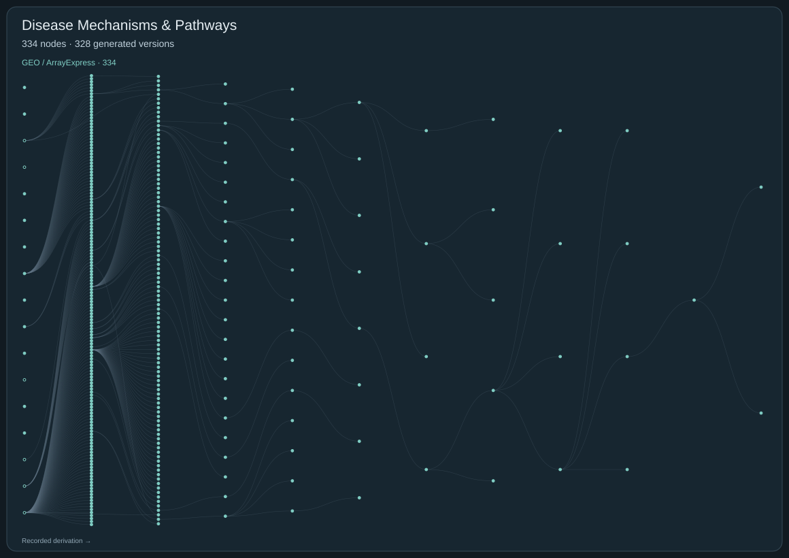

# Disease Mechanisms & Pathway Hypotheses

[← Blinded review index](../REVIEW.md)

**331 nodes · 325 generated versions · 317 recorded parent links.**

[Open the complete tree with node IDs](../figures/03-disease-mechanisms.svg). Download and open the SVG at native scale for readable, clickable IDs. On GitHub, use the catalogs below to open proposals and search by ID or scientific term. Hollow nodes are starting questions; filled nodes are generated versions. Every recorded parent edge is retained, including multi-parent derivations. Separate roots are not artificially joined.

## GEO / ArrayExpress

331 nodes

### D3-01A1FBD6CB · D3-M2 repair: directional macrophage–fibroblast communication in inflammatory synovial coculture

**Full scientific proposal:** [Read the public review copy](../proposals/D3-01A1FBD6CB.md)

**Derived from:** [D3-F680DC5C21](#d3-f680dc5c21)

**Type:** Generated hypothesis version

### D3-0262C1A1C9 · Pathway-resolved macrophage-to-fibroblast signaling in fibrotic coculture

**Full scientific proposal:** [Read the public review copy](../proposals/D3-0262C1A1C9.md)

**Derived from:** [D3-482E19704E](#d3-482e19704e)

**Type:** Generated hypothesis version

### D3-030229C94C · Working proposal (episode 4): Is the Mpos-macrophage -> FLS program a distinct state-shaping signal or generic inflammation, and does it track clinical remission?

**Full scientific proposal:** [Read the public review copy](../proposals/D3-030229C94C.md)

**Derived from:** [D3-9E2CC8C412](#d3-9e2cc8c412)

**Type:** Generated hypothesis version

### D3-032F5866DB · Provisional hypothesis: donor-aware macrophage-to-FLS communication in E-MTAB-8873

**Full scientific proposal:** [Read the public review copy](../proposals/D3-032F5866DB.md)

**Derived from:** [D3-07D2C4A134](#d3-07d2c4a134)

**Type:** Generated hypothesis version

### D3-03A2EFD7EE · Directional cell communication: macrophage-to-fibroblast versus fibroblast-to-macrophage signaling in RA

**Full scientific proposal:** [Read the public review copy](../proposals/D3-03A2EFD7EE.md)

**Derived from:** [D3-F680DC5C21](#d3-f680dc5c21)

**Type:** Generated hypothesis version

### D3-0469AB63D7 · D3-M2 repair: directional macrophage–fibroblast communication in inflammatory synovial coculture

**Full scientific proposal:** [Read the public review copy](../proposals/D3-0469AB63D7.md)

**Derived from:** [D3-F680DC5C21](#d3-f680dc5c21)

**Type:** Generated hypothesis version

### D3-04DC5CBC3D · Do remission-associated macrophage averages reflect captured state representation?

**Full scientific proposal:** [Read the public review copy](../proposals/D3-04DC5CBC3D.md)

**Derived from:** [D3-B03DDAADEF](#d3-b03ddaadef)

**Type:** Generated hypothesis version

### D3-06980A738F · Directional macrophage-to-fibroblast communication in rheumatoid arthritis

**Full scientific proposal:** [Read the public review copy](../proposals/D3-06980A738F.md)

**Derived from:** [D3-F680DC5C21](#d3-f680dc5c21)

**Type:** Generated hypothesis version

### D3-06FDC0448A · Directional macrophage-to-fibroblast signaling in RA synovium

**Full scientific proposal:** [Read the public review copy](../proposals/D3-06FDC0448A.md)

**Derived from:** [D3-70ED6687CB](#d3-70ed6687cb)

**Type:** Generated hypothesis version

### D3-0750529D61 · D3-M2 repair: directional macrophage–fibroblast communication in inflammatory synovial coculture

**Full scientific proposal:** [Read the public review copy](../proposals/D3-0750529D61.md)

**Derived from:** [D3-F680DC5C21](#d3-f680dc5c21)

**Type:** Generated hypothesis version

### D3-0758E89607 · Provisional hypothesis: directional macrophage-to-fibroblast signaling in synovial coculture

**Full scientific proposal:** [Read the public review copy](../proposals/D3-0758E89607.md)

**Derived from:** [D3-F680DC5C21](#d3-f680dc5c21)

**Type:** Generated hypothesis version

### D3-07D2C4A134 · Donor-aware macrophage-to-FLS communication in E-MTAB-8873

**Full scientific proposal:** [Read the public review copy](../proposals/D3-07D2C4A134.md)

**Derived from:** [D3-F680DC5C21](#d3-f680dc5c21)

**Type:** Generated hypothesis version

### D3-0858BA2AAB · D3-M3: Data-Driven Pathway Activity Inference in RA Synovial Tissue

**Full scientific proposal:** [Read the public review copy](../proposals/D3-0858BA2AAB.md)

**Derived from:** [D3-F4A1736A6C](#d3-f4a1736a6c)

**Type:** Generated hypothesis version

### D3-085CA47F7B · Directional cell communication: macrophage-to-fibroblast versus fibroblast-to-macrophage signaling in RA

**Full scientific proposal:** [Read the public review copy](../proposals/D3-085CA47F7B.md)

**Derived from:** [D3-F680DC5C21](#d3-f680dc5c21)

**Type:** Generated hypothesis version

### D3-09E585CCA8 · Directional macrophage-to-fibroblast communication in rheumatoid arthritis

**Full scientific proposal:** [Read the public review copy](../proposals/D3-09E585CCA8.md)

**Derived from:** [D3-F680DC5C21](#d3-f680dc5c21)

**Type:** Generated hypothesis version

### D3-0B2C9A87B8 · D3-M1: Composition versus Within-Cell Regulation of Inflammatory Signaling in RA Synovial Tissue

**Full scientific proposal:** [Read the public review copy](../proposals/D3-0B2C9A87B8.md)

**Derived from:** — (recorded root)

**Type:** Generated hypothesis version

### D3-0E15761F77 · Power-bounded null for acute MerTK-pathway inhibition: executed detectable-effect adjudication and the quantified stromal-output floor

**Full scientific proposal:** [Read the public review copy](../proposals/D3-0E15761F77.md)

**Derived from:** [D3-DDD8A21920](#d3-ddd8a21920)

**Type:** Generated hypothesis version

### D3-0E3762CE09 · D3-M2 repair: directional macrophage–fibroblast communication in inflammatory synovial coculture

**Full scientific proposal:** [Read the public review copy](../proposals/D3-0E3762CE09.md)

**Derived from:** [D3-F680DC5C21](#d3-f680dc5c21)

**Type:** Generated hypothesis version

### D3-0FBDCE512F · D3-M2 repair: directional macrophage–fibroblast communication in inflammatory synovial coculture

**Full scientific proposal:** [Read the public review copy](../proposals/D3-0FBDCE512F.md)

**Derived from:** [D3-F680DC5C21](#d3-f680dc5c21)

**Type:** Generated hypothesis version

### D3-11985B2E5F · MerTK specificity repair: a donor-blocked macrophage–FLS interaction test

**Full scientific proposal:** [Read the public review copy](../proposals/D3-11985B2E5F.md)

**Derived from:** [D3-2F9BE0A370](#d3-2f9be0a370)

**Type:** Generated hypothesis version

### D3-11AB18B3DF · Working proposal (episode 20): Does an Mpos->FLS program need MerTK signalling, donor-intrinsic FLS state, or just Mpos abundance?

**Full scientific proposal:** [Read the public review copy](../proposals/D3-11AB18B3DF.md)

**Derived from:** [D3-203D1326BF](#d3-203d1326bf)

**Type:** Generated hypothesis version

### D3-12F14EC91D · Temporal Feedback Structure of Macrophage-FLS Inflammatory Signaling in RA Synovial Tissue

**Full scientific proposal:** [Read the public review copy](../proposals/D3-12F14EC91D.md)

**Derived from:** — (recorded root)

**Type:** Generated hypothesis version

### D3-14CC5E7E10 · Temporal Feedback Structure of Macrophage-FLS Inflammatory Signaling in RA Synovial Tissue

**Full scientific proposal:** [Read the public review copy](../proposals/D3-14CC5E7E10.md)

**Derived from:** [D3-8669B7222D](#d3-8669b7222d)

**Type:** Generated hypothesis version

### D3-16B53E885E · Residual metabolic reprogramming in treatment-resistant RA macrophages: a distinct regulatory program or scaled inflammation?

**Full scientific proposal:** [Read the public review copy](../proposals/D3-16B53E885E.md)

**Derived from:** [D3-C6B46952BC](#d3-c6b46952bc)

**Type:** Generated hypothesis version

### D3-17F31A737B · Directional macrophage-to-fibroblast communication in rheumatoid arthritis

**Full scientific proposal:** [Read the public review copy](../proposals/D3-17F31A737B.md)

**Derived from:** [D3-F680DC5C21](#d3-f680dc5c21)

**Type:** Generated hypothesis version

### D3-1966155001 · Composition versus within-cell regulation in RA macrophage-fibroblast coculture

**Full scientific proposal:** [Read the public review copy](../proposals/D3-1966155001.md)

**Derived from:** [D3-1CEA8C9831](#d3-1cea8c9831)

**Type:** Generated hypothesis version

### D3-1C3AB40BF2 · D3-M3: Pathway-Activity Hypothesis — NF-κB/AP-1 Activation in RA Synovial Tissue

**Full scientific proposal:** [Read the public review copy](../proposals/D3-1C3AB40BF2.md)

**Derived from:** [D3-8669B7222D](#d3-8669b7222d)

**Type:** Generated hypothesis version

### D3-1C823B983C · E-MTAB-8873 pair-reconciliation evidence note

**Full scientific proposal:** [Read the public review copy](../proposals/D3-1C823B983C.md)

**Derived from:** [D3-961283A90E](#d3-961283a90e)

**Type:** Generated hypothesis version

### D3-1CD183003A · Working proposal (episode 20): Does an Mpos->FLS program need MerTK signalling, donor-intrinsic FLS state, or just Mpos abundance?

**Full scientific proposal:** [Read the public review copy](../proposals/D3-1CD183003A.md)

**Derived from:** [D3-203D1326BF](#d3-203d1326bf)

**Type:** Generated hypothesis version

### D3-1CEA8C9831 · Composition versus within-cell regulation

**Full scientific proposal:** [Read the public review copy](../proposals/D3-1CEA8C9831.md)

**Derived from:** — (recorded root)

**Type:** Starting question

### D3-203D1326BF · Working proposal (episode 18): Is the RA Mpos-macrophage -> FLS program a required intra-coculture MerTK-linked step beyond Mpos abundance?

**Full scientific proposal:** [Read the public review copy](../proposals/D3-203D1326BF.md)

**Derived from:** [D3-5A5E769307](#d3-5a5e769307)

**Type:** Generated hypothesis version

### D3-20A6350EA2 · Synovial macrophage remission signal: composition or within-state regulation?

**Full scientific proposal:** [Read the public review copy](../proposals/D3-20A6350EA2.md)

**Derived from:** [D3-9450FD8C77](#d3-9450fd8c77)

**Type:** Generated hypothesis version

### D3-218EBE5B78 · Pathway-resolved macrophage-to-fibroblast signaling in fibrotic coculture

**Full scientific proposal:** [Read the public review copy](../proposals/D3-218EBE5B78.md)

**Derived from:** [D3-482E19704E](#d3-482e19704e)

**Type:** Generated hypothesis version

### D3-232F6A22BB · Provisional repair: E-MTAB-8873 macrophage-context response in FLS

**Full scientific proposal:** [Read the public review copy](../proposals/D3-232F6A22BB.md)

**Derived from:** [D3-C9EE145938](#d3-c9ee145938)

**Type:** Generated hypothesis version

### D3-24FAB17842 · Does the remission–resistance macrophage signal travel across donors?

**Full scientific proposal:** [Read the public review copy](../proposals/D3-24FAB17842.md)

**Derived from:** [D3-3BC37E909C](#d3-3bc37e909c)

**Type:** Generated hypothesis version

### D3-25DE2DE7F4 · Directional macrophage-to-fibroblast communication in rheumatoid arthritis

**Full scientific proposal:** [Read the public review copy](../proposals/D3-25DE2DE7F4.md)

**Derived from:** [D3-F680DC5C21](#d3-f680dc5c21)

**Type:** Generated hypothesis version

### D3-25EE385D0B · Temporal Feedback Structure of Macrophage-FLS Inflammatory Signaling in RA Synovial Tissue

**Full scientific proposal:** [Read the public review copy](../proposals/D3-25EE385D0B.md)

**Derived from:** [D3-8669B7222D](#d3-8669b7222d)

**Type:** Generated hypothesis version

### D3-2603ED214B · Provisional hypothesis: donor-aware macrophage context in E-MTAB-8873

**Full scientific proposal:** [Read the public review copy](../proposals/D3-2603ED214B.md)

**Derived from:** [D3-1C823B983C](#d3-1c823b983c)

**Type:** Generated hypothesis version

### D3-26487E3BFF · Within-Cell Temporal Feedback of Macrophage-FLS Inflammatory Signaling in RA Synovial Tissue

**Full scientific proposal:** [Read the public review copy](../proposals/D3-26487E3BFF.md)

**Derived from:** [D3-D7FC29C28F](#d3-d7fc29c28f)

**Type:** Generated hypothesis version

### D3-2733722154 · Directional macrophage-to-fibroblast communication in rheumatoid arthritis

**Full scientific proposal:** [Read the public review copy](../proposals/D3-2733722154.md)

**Derived from:** [D3-F680DC5C21](#d3-f680dc5c21)

**Type:** Generated hypothesis version

### D3-293ED05432 · Evolution (episode 37): Does the resolution-like macrophage signal require a permissive FLS recipient?

**Full scientific proposal:** [Read the public review copy](../proposals/D3-293ED05432.md)

**Derived from:** [D3-8BF885FEF1](#d3-8bf885fef1)

**Type:** Generated hypothesis version

### D3-29E046FE66 · Directional macrophage-to-fibroblast communication in rheumatoid arthritis

**Full scientific proposal:** [Read the public review copy](../proposals/D3-29E046FE66.md)

**Derived from:** [D3-F680DC5C21](#d3-f680dc5c21)

**Type:** Generated hypothesis version

### D3-29E1A7B679 · Directional macrophage-to-fibroblast communication in rheumatoid arthritis

**Full scientific proposal:** [Read the public review copy](../proposals/D3-29E1A7B679.md)

**Derived from:** [D3-F680DC5C21](#d3-f680dc5c21)

**Type:** Generated hypothesis version

### D3-2B2CCBE2CE · Provisional repaired hypothesis: donor-aware macrophage-to-FLS response in E-MTAB-8873

**Full scientific proposal:** [Read the public review copy](../proposals/D3-2B2CCBE2CE.md)

**Derived from:** [D3-07D2C4A134](#d3-07d2c4a134)

**Type:** Generated hypothesis version

### D3-2B7A162DC5 · D3-M2 repair: directional macrophage–fibroblast communication in inflammatory synovial coculture

**Full scientific proposal:** [Read the public review copy](../proposals/D3-2B7A162DC5.md)

**Derived from:** [D3-F680DC5C21](#d3-f680dc5c21)

**Type:** Generated hypothesis version

### D3-2C1BD669D1 · Does UNC1062-associated FLS response depend on the macrophage subset?

**Full scientific proposal:** [Read the public review copy](../proposals/D3-2C1BD669D1.md)

**Derived from:** [D3-F680DC5C21](#d3-f680dc5c21)

**Type:** Generated hypothesis version

### D3-2C437EA661 · Provisional hypothesis: MerTK-positive macrophage context induces a reproducible FLS transcriptional response in E-MTAB-8873

**Full scientific proposal:** [Read the public review copy](../proposals/D3-2C437EA661.md)

**Derived from:** [D3-07D2C4A134](#d3-07d2c4a134)

**Type:** Generated hypothesis version

### D3-2CB99BB540 · Pathway-resolved macrophage-to-fibroblast signaling in fibrotic coculture

**Full scientific proposal:** [Read the public review copy](../proposals/D3-2CB99BB540.md)

**Derived from:** [D3-482E19704E](#d3-482e19704e)

**Type:** Generated hypothesis version

### D3-2CC0057EB7 · JAK-STAT Dependence of Macrophage-Induced FLS Inflammatory Response in RA Synovial Tissue

**Full scientific proposal:** [Read the public review copy](../proposals/D3-2CC0057EB7.md)

**Derived from:** [D3-949E0D1CC4](#d3-949e0d1cc4)

**Type:** Generated hypothesis version

### D3-2D34D63A75 · D3-M3: Data-Driven Pathway Activity Inference in RA Synovial Tissue

**Full scientific proposal:** [Read the public review copy](../proposals/D3-2D34D63A75.md)

**Derived from:** [D3-F4A1736A6C](#d3-f4a1736a6c)

**Type:** Generated hypothesis version

### D3-2DC288DF97 · Non-LPS bounded null for acute MerTK-pathway inhibition: executed donor-aware REML adjudication on E-MTAB-8873

**Full scientific proposal:** [Read the public review copy](../proposals/D3-2DC288DF97.md)

**Derived from:** [D3-0E15761F77](#d3-0e15761f77)

**Type:** Generated hypothesis version

### D3-2F67BA7369 · Pathway-resolved macrophage-to-fibroblast signaling in fibrotic coculture

**Full scientific proposal:** [Read the public review copy](../proposals/D3-2F67BA7369.md)

**Derived from:** [D3-482E19704E](#d3-482e19704e)

**Type:** Generated hypothesis version

### D3-2F9BE0A370 · MerTK-conditioned macrophage–fibroblast communication in rheumatoid arthritis

**Full scientific proposal:** [Read the public review copy](../proposals/D3-2F9BE0A370.md)

**Derived from:** [D3-F680DC5C21](#d3-f680dc5c21)

**Type:** Generated hypothesis version

### D3-30031722D4 · Temporal Feedback Structure of Macrophage-FLS Inflammatory Signaling in RA Synovial Tissue

**Full scientific proposal:** [Read the public review copy](../proposals/D3-30031722D4.md)

**Derived from:** [D3-8669B7222D](#d3-8669b7222d)

**Type:** Generated hypothesis version

### D3-30D8C7F0F7 · Directional macrophage-to-fibroblast communication in rheumatoid arthritis

**Full scientific proposal:** [Read the public review copy](../proposals/D3-30D8C7F0F7.md)

**Derived from:** [D3-F680DC5C21](#d3-f680dc5c21)

**Type:** Generated hypothesis version

### D3-30F535150B · Temporal Feedback Structure of Macrophage-FLS Inflammatory Signaling in RA Synovial Tissue

**Full scientific proposal:** [Read the public review copy](../proposals/D3-30F535150B.md)

**Derived from:** [D3-8669B7222D](#d3-8669b7222d)

**Type:** Generated hypothesis version

### D3-3107AF631C · Pathway-resolved macrophage-to-fibroblast signaling in fibrotic coculture

**Full scientific proposal:** [Read the public review copy](../proposals/D3-3107AF631C.md)

**Derived from:** [D3-482E19704E](#d3-482e19704e)

**Type:** Generated hypothesis version

### D3-327B363794 · Directional macrophage-to-fibroblast communication in OA-like cocultures

**Full scientific proposal:** [Read the public review copy](../proposals/D3-327B363794.md)

**Derived from:** [D3-F680DC5C21](#d3-f680dc5c21)

**Type:** Generated hypothesis version

### D3-3323CCD044 · Pathway-resolved macrophage-to-fibroblast signaling in fibrotic coculture

**Full scientific proposal:** [Read the public review copy](../proposals/D3-3323CCD044.md)

**Derived from:** [D3-482E19704E](#d3-482e19704e)

**Type:** Generated hypothesis version

### D3-3350C63220 · Provisional hypothesis: donor- and composition-aware macrophage-to-FLS communication in E-MTAB-8873

**Full scientific proposal:** [Read the public review copy](../proposals/D3-3350C63220.md)

**Derived from:** [D3-950CB7F08D](#d3-950cb7f08d)

**Type:** Generated hypothesis version

### D3-33735E3AC2 · Donor-aware macrophage-to-FLS communication in E-MTAB-8873

**Full scientific proposal:** [Read the public review copy](../proposals/D3-33735E3AC2.md)

**Derived from:** [D3-07D2C4A134](#d3-07d2c4a134)

**Type:** Generated hypothesis version

### D3-33A768666E · Do remission-associated macrophage averages reflect captured state representation?

**Full scientific proposal:** [Read the public review copy](../proposals/D3-33A768666E.md)

**Derived from:** [D3-3BC37E909C](#d3-3bc37e909c)

**Type:** Generated hypothesis version

### D3-341123BDCC · Directional macrophage-to-fibroblast communication in rheumatoid arthritis

**Full scientific proposal:** [Read the public review copy](../proposals/D3-341123BDCC.md)

**Derived from:** [D3-F680DC5C21](#d3-f680dc5c21)

**Type:** Generated hypothesis version

### D3-34CBF70987 · Provisional repair: donor-conditioned macrophage exposure in E-MTAB-8873

**Full scientific proposal:** [Read the public review copy](../proposals/D3-34CBF70987.md)

**Derived from:** [D3-07D2C4A134](#d3-07d2c4a134)

**Type:** Generated hypothesis version

### D3-34DC38342A · D3-M2 repair: directional macrophage–fibroblast communication in inflammatory synovial coculture

**Full scientific proposal:** [Read the public review copy](../proposals/D3-34DC38342A.md)

**Derived from:** [D3-F680DC5C21](#d3-f680dc5c21)

**Type:** Generated hypothesis version

### D3-358DCDB84E · MerTK-dependent macrophage-to-fibroblast signaling drives fibroblast activation in rheumatoid arthritis

**Full scientific proposal:** [Read the public review copy](../proposals/D3-358DCDB84E.md)

**Derived from:** [D3-F680DC5C21](#d3-f680dc5c21)

**Type:** Generated hypothesis version

### D3-3631D0132B · D3-M2: MerTK-Dependent Macrophage-to-FLS Signaling (EXECUTED)

**Full scientific proposal:** [Read the public review copy](../proposals/D3-3631D0132B.md)

**Derived from:** [D3-358DCDB84E](#d3-358dcdb84e)

**Type:** Generated hypothesis version

### D3-3968E6163A · D3-M2 repair: directional macrophage–fibroblast communication in inflammatory synovial coculture

**Full scientific proposal:** [Read the public review copy](../proposals/D3-3968E6163A.md)

**Derived from:** [D3-F680DC5C21](#d3-f680dc5c21)

**Type:** Generated hypothesis version

### D3-3AA02516A1 · Temporal Feedback Structure of Macrophage-FLS Inflammatory Signaling in RA Synovial Tissue

**Full scientific proposal:** [Read the public review copy](../proposals/D3-3AA02516A1.md)

**Derived from:** [D3-8669B7222D](#d3-8669b7222d)

**Type:** Generated hypothesis version

### D3-3AB019BF79 · Directional macrophage-to-fibroblast communication in rheumatoid arthritis

**Full scientific proposal:** [Read the public review copy](../proposals/D3-3AB019BF79.md)

**Derived from:** [D3-F680DC5C21](#d3-f680dc5c21)

**Type:** Generated hypothesis version

### D3-3B5B57A9EF · Pathway-resolved macrophage-to-fibroblast signaling in fibrotic coculture

**Full scientific proposal:** [Read the public review copy](../proposals/D3-3B5B57A9EF.md)

**Derived from:** [D3-482E19704E](#d3-482e19704e)

**Type:** Generated hypothesis version

### D3-3BC37E909C · Synovial macrophage remission signal: composition or within-state regulation?

**Full scientific proposal:** [Read the public review copy](../proposals/D3-3BC37E909C.md)

**Derived from:** [D3-20A6350EA2](#d3-20a6350ea2)

**Type:** Generated hypothesis version

### D3-3CC34063E0 · Provisional hypothesis: E-MTAB-8873 macrophage context and donor composition

**Full scientific proposal:** [Read the public review copy](../proposals/D3-3CC34063E0.md)

**Derived from:** [D3-7615B13362](#d3-7615b13362)

**Type:** Generated hypothesis version

### D3-3D4F53DF54 · Provisional hypothesis: donor-aware macrophage-to-FLS communication in E-MTAB-8873

**Full scientific proposal:** [Read the public review copy](../proposals/D3-3D4F53DF54.md)

**Derived from:** [D3-07D2C4A134](#d3-07d2c4a134)

**Type:** Generated hypothesis version

### D3-3DBCBCD269 · Pathway-resolved macrophage-to-fibroblast signaling in fibrotic coculture

**Full scientific proposal:** [Read the public review copy](../proposals/D3-3DBCBCD269.md)

**Derived from:** [D3-482E19704E](#d3-482e19704e)

**Type:** Generated hypothesis version

### D3-3E158E32EE · Pathway-resolved macrophage-to-fibroblast signaling in fibrotic coculture

**Full scientific proposal:** [Read the public review copy](../proposals/D3-3E158E32EE.md)

**Derived from:** [D3-482E19704E](#d3-482e19704e)

**Type:** Generated hypothesis version

### D3-3F5C4AE2A7 · Directional macrophage→FLS communication in RA: does macrophage STATE imprint a reproducible FLS transcriptional response?

**Full scientific proposal:** [Read the public review copy](../proposals/D3-3F5C4AE2A7.md)

**Derived from:** [D3-F680DC5C21](#d3-f680dc5c21)

**Type:** Generated hypothesis version

### D3-4060F90F3C · JAK-STAT Dependence of Macrophage-Induced FLS Inflammatory Response in RA Synovial Tissue

**Full scientific proposal:** [Read the public review copy](../proposals/D3-4060F90F3C.md)

**Derived from:** [D3-949E0D1CC4](#d3-949e0d1cc4)

**Type:** Generated hypothesis version

### D3-40C4C1C3D4 · Pathway-resolved macrophage-to-fibroblast signaling in fibrotic coculture

**Full scientific proposal:** [Read the public review copy](../proposals/D3-40C4C1C3D4.md)

**Derived from:** [D3-482E19704E](#d3-482e19704e)

**Type:** Generated hypothesis version

### D3-4244439FC9 · Provisional hypothesis: donor-aware macrophage-to-FLS communication in E-MTAB-8873

**Full scientific proposal:** [Read the public review copy](../proposals/D3-4244439FC9.md)

**Derived from:** [D3-950CB7F08D](#d3-950cb7f08d)

**Type:** Generated hypothesis version

### D3-42584839E3 · Pathway-resolved macrophage-to-fibroblast signaling in fibrotic coculture

**Full scientific proposal:** [Read the public review copy](../proposals/D3-42584839E3.md)

**Derived from:** [D3-482E19704E](#d3-482e19704e)

**Type:** Generated hypothesis version

### D3-425A7B58BD · Working proposal (episode 15): Is the RA Mpos-macrophage -> FLS program a required MerTK-signalling step, or FLS-donor/composition abundance?

**Full scientific proposal:** [Read the public review copy](../proposals/D3-425A7B58BD.md)

**Derived from:** [D3-B42D5FCAC8](#d3-b42d5fcac8)

**Type:** Generated hypothesis version

### D3-42DD0629EF · Pathway-resolved macrophage-to-fibroblast signaling in fibrotic coculture

**Full scientific proposal:** [Read the public review copy](../proposals/D3-42DD0629EF.md)

**Derived from:** [D3-482E19704E](#d3-482e19704e)

**Type:** Generated hypothesis version

### D3-44749687EB · D3-M1 repair: Composition versus within-cell regulation in the active-RA vs remission synovial macrophage contrast

**Full scientific proposal:** [Read the public review copy](../proposals/D3-44749687EB.md)

**Derived from:** [D3-1CEA8C9831](#d3-1cea8c9831)

**Type:** Generated hypothesis version

### D3-448796FA82 · Pathway-resolved macrophage-to-fibroblast signaling in fibrotic coculture

**Full scientific proposal:** [Read the public review copy](../proposals/D3-448796FA82.md)

**Derived from:** [D3-482E19704E](#d3-482e19704e)

**Type:** Generated hypothesis version

### D3-4586BD18F4 · Temporal Feedback Structure of Macrophage-FLS Inflammatory Signaling in RA Synovial Tissue

**Full scientific proposal:** [Read the public review copy](../proposals/D3-4586BD18F4.md)

**Derived from:** [D3-8669B7222D](#d3-8669b7222d)

**Type:** Generated hypothesis version

### D3-45BD316BC6 · Composition versus within-cell regulation

**Full scientific proposal:** [Read the public review copy](../proposals/D3-45BD316BC6.md)

**Derived from:** — (recorded root)

**Type:** Starting question

### D3-47AB115BE4 · Provisional donor-aware hypothesis: MerTK-positive macrophage context induces a reproducible FLS transcriptional response in E-MTAB-8873

**Full scientific proposal:** [Read the public review copy](../proposals/D3-47AB115BE4.md)

**Derived from:** [D3-07D2C4A134](#d3-07d2c4a134)

**Type:** Generated hypothesis version

### D3-480A2A62D2 · Pathway-resolved macrophage-to-fibroblast signaling in fibrotic coculture

**Full scientific proposal:** [Read the public review copy](../proposals/D3-480A2A62D2.md)

**Derived from:** [D3-482E19704E](#d3-482e19704e)

**Type:** Generated hypothesis version

### D3-482E19704E · Directional macrophage-to-fibroblast signaling in fibrotic coculture

**Full scientific proposal:** [Read the public review copy](../proposals/D3-482E19704E.md)

**Derived from:** [D3-F680DC5C21](#d3-f680dc5c21)

**Type:** Generated hypothesis version

### D3-496A8C81C2 · Directional cell communication: macrophage-to-fibroblast versus fibroblast-to-macrophage signaling in RA

**Full scientific proposal:** [Read the public review copy](../proposals/D3-496A8C81C2.md)

**Derived from:** [D3-F680DC5C21](#d3-f680dc5c21)

**Type:** Generated hypothesis version

### D3-4A173A4576 · Directional macrophage-to-fibroblast communication in OA-like cocultures

**Full scientific proposal:** [Read the public review copy](../proposals/D3-4A173A4576.md)

**Derived from:** [D3-F680DC5C21](#d3-f680dc5c21)

**Type:** Generated hypothesis version

### D3-4AE9BCBEB5 · Pathway-resolved macrophage-to-fibroblast signaling in fibrotic coculture

**Full scientific proposal:** [Read the public review copy](../proposals/D3-4AE9BCBEB5.md)

**Derived from:** [D3-482E19704E](#d3-482e19704e)

**Type:** Generated hypothesis version

### D3-4F296B00DA · Provisional hypothesis: donor-aware macrophage-to-FLS communication in E-MTAB-8873

**Full scientific proposal:** [Read the public review copy](../proposals/D3-4F296B00DA.md)

**Derived from:** [D3-950CB7F08D](#d3-950cb7f08d)

**Type:** Generated hypothesis version

### D3-50126BCD94 · Provisional hypothesis: donor-aware macrophage-to-FLS communication in E-MTAB-8873

**Full scientific proposal:** [Read the public review copy](../proposals/D3-50126BCD94.md)

**Derived from:** [D3-07D2C4A134](#d3-07d2c4a134)

**Type:** Generated hypothesis version

### D3-507D53F05C · Working proposal (episode 29): Is the RA resolution macrophage program a titratable, MerTK-reversible paracrine axis — or a composition/stimulus bystander?

**Full scientific proposal:** [Read the public review copy](../proposals/D3-507D53F05C.md)

**Derived from:** [D3-E03F90182E](#d3-e03f90182e)

**Type:** Generated hypothesis version

### D3-511928DD54 · Macrophage-condition dominance over FLS inflammatory output: executed pilot adjudication of composition, MerTK-pathway-state and FLS-intrinsic arms

**Full scientific proposal:** [Read the public review copy](../proposals/D3-511928DD54.md)

**Derived from:** [D3-72F9579693](#d3-72f9579693)

**Type:** Generated hypothesis version

### D3-51297CF67A · Temporal Feedback Structure of Macrophage-FLS Inflammatory Signaling in RA Synovial Tissue

**Full scientific proposal:** [Read the public review copy](../proposals/D3-51297CF67A.md)

**Derived from:** — (recorded root)

**Type:** Generated hypothesis version

### D3-522996CC5D · Provisional hypothesis: reproducibility of macrophage-condition transcriptional response in E-MTAB-8873

**Full scientific proposal:** [Read the public review copy](../proposals/D3-522996CC5D.md)

**Derived from:** [D3-950CB7F08D](#d3-950cb7f08d)

**Type:** Generated hypothesis version

### D3-5233C32F8B · Context-Specific Pathway Activity in RA Synovial Tissue: Fixed Membership vs. Data-Driven Inference

**Full scientific proposal:** [Read the public review copy](../proposals/D3-5233C32F8B.md)

**Derived from:** [D3-8669B7222D](#d3-8669b7222d)

**Type:** Generated hypothesis version

### D3-52E8FE77A4 · Composition versus within-cell regulation of macrophage inflammatory signatures in RA

**Full scientific proposal:** [Read the public review copy](../proposals/D3-52E8FE77A4.md)

**Derived from:** [D3-1CEA8C9831](#d3-1cea8c9831)

**Type:** Generated hypothesis version

### D3-551535723A · JAK Inhibition Redirects LPS-Driven Monocyte Inflammation from IFN/STAT to NF-κB/IL-6 in RA: A Pathway-Specific, Not Global, Effect

**Full scientific proposal:** [Read the public review copy](../proposals/D3-551535723A.md)

**Derived from:** — (recorded root)

**Type:** Generated hypothesis version

### D3-56425759F6 · D3-M2: Macrophage-State-Specific Fibroblast Programming in RA Synovium — Does MerTK Signaling Mediate the MerTKpos→FLS Response?

**Full scientific proposal:** [Read the public review copy](../proposals/D3-56425759F6.md)

**Derived from:** [D3-F680DC5C21](#d3-f680dc5c21)

**Type:** Generated hypothesis version

### D3-57970EB428 · Temporal Feedback Structure of Macrophage-FLS Inflammatory Signaling in RA Synovial Tissue

**Full scientific proposal:** [Read the public review copy](../proposals/D3-57970EB428.md)

**Derived from:** — (recorded root)

**Type:** Generated hypothesis version

### D3-57A2402937 · Temporal Feedback Structure of Macrophage-FLS Inflammatory Signaling in RA Synovial Tissue

**Full scientific proposal:** [Read the public review copy](../proposals/D3-57A2402937.md)

**Derived from:** [D3-8669B7222D](#d3-8669b7222d)

**Type:** Generated hypothesis version

### D3-58C8271F50 · Directional macrophage-to-fibroblast communication in OA-like cocultures

**Full scientific proposal:** [Read the public review copy](../proposals/D3-58C8271F50.md)

**Derived from:** [D3-F680DC5C21](#d3-f680dc5c21)

**Type:** Generated hypothesis version

### D3-59DFCEE91F · Temporal Feedback Structure of Macrophage-FLS Inflammatory Signaling in RA Synovial Tissue

**Full scientific proposal:** [Read the public review copy](../proposals/D3-59DFCEE91F.md)

**Derived from:** [D3-8669B7222D](#d3-8669b7222d)

**Type:** Generated hypothesis version

### D3-5A5E769307 · Working proposal (episode 15): Is the RA Mpos-macrophage -> FLS program a required MerTK-signalling step, or FLS-donor/composition abundance?

**Full scientific proposal:** [Read the public review copy](../proposals/D3-5A5E769307.md)

**Derived from:** [D3-B42D5FCAC8](#d3-b42d5fcac8)

**Type:** Generated hypothesis version

### D3-5AE17F8AD6 · Working proposal (episode 27): Composition shift or within-cell program in the RA remission-vs-resistant synovial macrophage axis?

**Full scientific proposal:** [Read the public review copy](../proposals/D3-5AE17F8AD6.md)

**Derived from:** [D3-E03F90182E](#d3-e03f90182e)

**Type:** Generated hypothesis version

### D3-5B10FE5603 · Directional macrophage-to-fibroblast communication in rheumatoid arthritis

**Full scientific proposal:** [Read the public review copy](../proposals/D3-5B10FE5603.md)

**Derived from:** [D3-F680DC5C21](#d3-f680dc5c21)

**Type:** Generated hypothesis version

### D3-5B3B33BF2B · Provisional hypothesis: macrophage context induces a reproducible within-FLS state response

**Full scientific proposal:** [Read the public review copy](../proposals/D3-5B3B33BF2B.md)

**Derived from:** [D3-C9EE145938](#d3-c9ee145938)

**Type:** Generated hypothesis version

### D3-5C02E4F2F1 · Robustness of the state-specific metabolic reprogramming signal in treatment-resistant RA macrophages to age and sex adjustment

**Full scientific proposal:** [Read the public review copy](../proposals/D3-5C02E4F2F1.md)

**Derived from:** [D3-A5F14D7BB8](#d3-a5f14d7bb8)

**Type:** Generated hypothesis version

### D3-5CD73C88F7 · D3-M2 repair: directional macrophage–fibroblast communication in inflammatory synovial coculture

**Full scientific proposal:** [Read the public review copy](../proposals/D3-5CD73C88F7.md)

**Derived from:** [D3-F680DC5C21](#d3-f680dc5c21)

**Type:** Generated hypothesis version

### D3-5D3EEE7A39 · D3-M3: Data-Driven Pathway Activity Inference in RA Synovial Tissue

**Full scientific proposal:** [Read the public review copy](../proposals/D3-5D3EEE7A39.md)

**Derived from:** [D3-F4A1736A6C](#d3-f4a1736a6c)

**Type:** Generated hypothesis version

### D3-5D4BA78F6A · Temporal Feedback Structure of Macrophage-FLS Inflammatory Signaling in RA Synovial Tissue

**Full scientific proposal:** [Read the public review copy](../proposals/D3-5D4BA78F6A.md)

**Derived from:** [D3-8669B7222D](#d3-8669b7222d)

**Type:** Generated hypothesis version

### D3-5DB6366839 · Directional macrophage-to-fibroblast communication in rheumatoid arthritis

**Full scientific proposal:** [Read the public review copy](../proposals/D3-5DB6366839.md)

**Derived from:** [D3-F680DC5C21](#d3-f680dc5c21)

**Type:** Generated hypothesis version

### D3-5E8F1DFB3F · Pathway-resolved macrophage-to-fibroblast signaling in fibrotic coculture

**Full scientific proposal:** [Read the public review copy](../proposals/D3-5E8F1DFB3F.md)

**Derived from:** [D3-482E19704E](#d3-482e19704e)

**Type:** Generated hypothesis version

### D3-5EF4D5BD9F · Temporal Feedback Structure of Macrophage-FLS Inflammatory Signaling in RA Synovial Tissue

**Full scientific proposal:** [Read the public review copy](../proposals/D3-5EF4D5BD9F.md)

**Derived from:** [D3-8669B7222D](#d3-8669b7222d)

**Type:** Generated hypothesis version

### D3-5F371862E5 · Directional macrophage-to-fibroblast communication in rheumatoid arthritis

**Full scientific proposal:** [Read the public review copy](../proposals/D3-5F371862E5.md)

**Derived from:** [D3-F680DC5C21](#d3-f680dc5c21)

**Type:** Generated hypothesis version

### D3-5F5D04EF20 · Pathway-resolved macrophage-to-fibroblast signaling in fibrotic coculture

**Full scientific proposal:** [Read the public review copy](../proposals/D3-5F5D04EF20.md)

**Derived from:** [D3-482E19704E](#d3-482e19704e)

**Type:** Generated hypothesis version

### D3-5FFA06A532 · Provisional hypothesis: MerTK-positive macrophage context induces a reproducible FLS transcriptional response in E-MTAB-8873

**Full scientific proposal:** [Read the public review copy](../proposals/D3-5FFA06A532.md)

**Derived from:** [D3-07D2C4A134](#d3-07d2c4a134)

**Type:** Generated hypothesis version

### D3-605A9A9288 · Provisional hypothesis: donor-aware macrophage-to-FLS communication in E-MTAB-8873

**Full scientific proposal:** [Read the public review copy](../proposals/D3-605A9A9288.md)

**Derived from:** [D3-07D2C4A134](#d3-07d2c4a134)

**Type:** Generated hypothesis version

### D3-60654F2605 · Temporal Feedback Structure of Macrophage-FLS Inflammatory Signaling in RA Synovial Tissue

**Full scientific proposal:** [Read the public review copy](../proposals/D3-60654F2605.md)

**Derived from:** [D3-8669B7222D](#d3-8669b7222d)

**Type:** Generated hypothesis version

### D3-60C3F8029D · Provisional hypothesis: donor-aware macrophage-to-FLS communication in E-MTAB-8873

**Full scientific proposal:** [Read the public review copy](../proposals/D3-60C3F8029D.md)

**Derived from:** [D3-950CB7F08D](#d3-950cb7f08d)

**Type:** Generated hypothesis version

### D3-613A9BEA4D · Within-macrophage inflammatory state, not composition, drives the macrophage-associated signal

**Full scientific proposal:** [Read the public review copy](../proposals/D3-613A9BEA4D.md)

**Derived from:** [D3-1CEA8C9831](#d3-1cea8c9831)

**Type:** Generated hypothesis version

### D3-6170DC27CF · Provisional hypothesis: donor-aware macrophage-to-FLS communication in E-MTAB-8873

**Full scientific proposal:** [Read the public review copy](../proposals/D3-6170DC27CF.md)

**Derived from:** [D3-07D2C4A134](#d3-07d2c4a134)

**Type:** Generated hypothesis version

### D3-6182BC90AC · Directional macrophage-to-fibroblast communication in OA-like cocultures

**Full scientific proposal:** [Read the public review copy](../proposals/D3-6182BC90AC.md)

**Derived from:** [D3-F680DC5C21](#d3-f680dc5c21)

**Type:** Generated hypothesis version

### D3-61D55DAA15 · Directional macrophage-to-fibroblast communication in rheumatoid arthritis

**Full scientific proposal:** [Read the public review copy](../proposals/D3-61D55DAA15.md)

**Derived from:** [D3-F680DC5C21](#d3-f680dc5c21)

**Type:** Generated hypothesis version

### D3-61DA2BC514 · Temporal Feedback Structure of Macrophage-FLS Inflammatory Signaling in RA Synovial Tissue

**Full scientific proposal:** [Read the public review copy](../proposals/D3-61DA2BC514.md)

**Derived from:** [D3-8669B7222D](#d3-8669b7222d)

**Type:** Generated hypothesis version

### D3-646EB286F3 · Pathway-resolved macrophage-to-fibroblast signaling in fibrotic coculture

**Full scientific proposal:** [Read the public review copy](../proposals/D3-646EB286F3.md)

**Derived from:** [D3-482E19704E](#d3-482e19704e)

**Type:** Generated hypothesis version

### D3-65615B2082 · Provisional hypothesis: macrophage context changes FLS transcript state beyond donor composition

**Full scientific proposal:** [Read the public review copy](../proposals/D3-65615B2082.md)

**Derived from:** [D3-8E76453165](#d3-8e76453165)

**Type:** Generated hypothesis version

### D3-6612820E43 · D3-M3: Pathway-Activity Hypothesis — NF-κB/AP-1 Activation in RA Synovial Tissue

**Full scientific proposal:** [Read the public review copy](../proposals/D3-6612820E43.md)

**Derived from:** [D3-8669B7222D](#d3-8669b7222d)

**Type:** Generated hypothesis version

### D3-66302C4504 · Directional macrophage-to-fibroblast communication in rheumatoid arthritis

**Full scientific proposal:** [Read the public review copy](../proposals/D3-66302C4504.md)

**Derived from:** [D3-F680DC5C21](#d3-f680dc5c21)

**Type:** Generated hypothesis version

### D3-678CC9B4E0 · Provisional repaired hypothesis: donor-aware macrophage-to-FLS response in E-MTAB-8873

**Full scientific proposal:** [Read the public review copy](../proposals/D3-678CC9B4E0.md)

**Derived from:** [D3-07D2C4A134](#d3-07d2c4a134)

**Type:** Generated hypothesis version

### D3-6797C0C0F1 · Temporal Feedback Structure of Macrophage-FLS Inflammatory Signaling in RA Synovial Tissue

**Full scientific proposal:** [Read the public review copy](../proposals/D3-6797C0C0F1.md)

**Derived from:** [D3-8669B7222D](#d3-8669b7222d)

**Type:** Generated hypothesis version

### D3-67FC6458F6 · D3-M3: Data-Driven Pathway Activity Inference in RA Synovial Tissue

**Full scientific proposal:** [Read the public review copy](../proposals/D3-67FC6458F6.md)

**Derived from:** [D3-F4A1736A6C](#d3-f4a1736a6c)

**Type:** Generated hypothesis version

### D3-68B562A910 · Provisional hypothesis: donor-aware macrophage-to-FLS communication in E-MTAB-8873

**Full scientific proposal:** [Read the public review copy](../proposals/D3-68B562A910.md)

**Derived from:** [D3-823EBB56CB](#d3-823ebb56cb)

**Type:** Generated hypothesis version

### D3-68E46890B8 · Robustness of the state-specific metabolic reprogramming signal in treatment-resistant RA macrophages to age and sex adjustment

**Full scientific proposal:** [Read the public review copy](../proposals/D3-68E46890B8.md)

**Derived from:** [D3-A5F14D7BB8](#d3-a5f14d7bb8)

**Type:** Generated hypothesis version

### D3-69131BC5C4 · Provisional hypothesis: donor-aware macrophage-to-FLS communication in E-MTAB-8873

**Full scientific proposal:** [Read the public review copy](../proposals/D3-69131BC5C4.md)

**Derived from:** [D3-950CB7F08D](#d3-950cb7f08d)

**Type:** Generated hypothesis version

### D3-6A6F4577E5 · Evolution (episode 30): Composition vs. within-cell test of the RA drug-free-remission synovial-macrophage program

**Full scientific proposal:** [Read the public review copy](../proposals/D3-6A6F4577E5.md)

**Derived from:** [D3-E03F90182E](#d3-e03f90182e)

**Type:** Generated hypothesis version

### D3-6A7C3B54E0 · Temporal Feedback Structure of Macrophage-FLS Inflammatory Signaling in RA Synovial Tissue

**Full scientific proposal:** [Read the public review copy](../proposals/D3-6A7C3B54E0.md)

**Derived from:** [D3-8669B7222D](#d3-8669b7222d)

**Type:** Generated hypothesis version

### D3-6C85E0A5DB · Directional macrophage-to-fibroblast communication in rheumatoid arthritis

**Full scientific proposal:** [Read the public review copy](../proposals/D3-6C85E0A5DB.md)

**Derived from:** [D3-F680DC5C21](#d3-f680dc5c21)

**Type:** Generated hypothesis version

### D3-6C9406CBC3 · Working proposal (episode 4): Is the Mpos-macrophage -> FLS program a distinct state-shaping signal or generic inflammation, and does it track clinical remission?

**Full scientific proposal:** [Read the public review copy](../proposals/D3-6C9406CBC3.md)

**Derived from:** [D3-9E2CC8C412](#d3-9e2cc8c412)

**Type:** Generated hypothesis version

### D3-6CA9BC10D1 · Provisional hypothesis: macrophage context changes FLS state beyond composition

**Full scientific proposal:** [Read the public review copy](../proposals/D3-6CA9BC10D1.md)

**Derived from:** [D3-FC9EC56539](#d3-fc9ec56539)

**Type:** Generated hypothesis version

### D3-6F24129C6D · Working proposal (episode 4): Is the Mpos-macrophage -> FLS program a distinct state-shaping signal or generic inflammation, and does it track clinical remission?

**Full scientific proposal:** [Read the public review copy](../proposals/D3-6F24129C6D.md)

**Derived from:** [D3-9E2CC8C412](#d3-9e2cc8c412)

**Type:** Generated hypothesis version

### D3-6F9BA3DF18 · Pathway-resolved macrophage-to-fibroblast signaling in fibrotic coculture

**Full scientific proposal:** [Read the public review copy](../proposals/D3-6F9BA3DF18.md)

**Derived from:** [D3-482E19704E](#d3-482e19704e)

**Type:** Generated hypothesis version

### D3-703BB194D3 · Cross-assay validation of the MerTK-dependent macrophage-to-FLS signaling signature: targeted panel versus full transcriptome

**Full scientific proposal:** [Read the public review copy](../proposals/D3-703BB194D3.md)

**Derived from:** [D3-358DCDB84E](#d3-358dcdb84e)

**Type:** Generated hypothesis version

### D3-70ED6687CB · Directional macrophage-to-fibroblast signaling in RA synovium

**Full scientific proposal:** [Read the public review copy](../proposals/D3-70ED6687CB.md)

**Derived from:** [D3-F680DC5C21](#d3-f680dc5c21)

**Type:** Generated hypothesis version

### D3-71004A575D · Pathway-resolved macrophage-to-fibroblast signaling in fibrotic coculture

**Full scientific proposal:** [Read the public review copy](../proposals/D3-71004A575D.md)

**Derived from:** [D3-482E19704E](#d3-482e19704e)

**Type:** Generated hypothesis version

### D3-710CFBF609 · Temporal Feedback Structure of Macrophage-FLS Inflammatory Signaling in RA Synovial Tissue

**Full scientific proposal:** [Read the public review copy](../proposals/D3-710CFBF609.md)

**Derived from:** [D3-8669B7222D](#d3-8669b7222d)

**Type:** Generated hypothesis version

### D3-71D39644BE · Directional macrophage-to-fibroblast communication in OA-like cocultures

**Full scientific proposal:** [Read the public review copy](../proposals/D3-71D39644BE.md)

**Derived from:** [D3-327B363794](#d3-327b363794)

**Type:** Generated hypothesis version

### D3-7276AD84F6 · Corrected MerTK off-target control analysis on E-MTAB-8873 — managed-compute re-execution (D3-M2, ep14)

**Full scientific proposal:** [Read the public review copy](../proposals/D3-7276AD84F6.md)

**Derived from:** [D3-9DC1CCC95A](#d3-9dc1ccc95a)

**Type:** Generated hypothesis version

### D3-72A9B734A9 · Full-Transcriptome MerTK Inhibitor Analysis in FLS-Macrophage Co-culture: Executed Null Result

**Full scientific proposal:** [Read the public review copy](../proposals/D3-72A9B734A9.md)

**Derived from:** [D3-358DCDB84E](#d3-358dcdb84e)

**Type:** Generated hypothesis version

### D3-72F9579693 · MerTK-pathway state versus macrophage-subset composition as the driver of fibroblast inflammatory output in RA synovial coculture

**Full scientific proposal:** [Read the public review copy](../proposals/D3-72F9579693.md)

**Derived from:** [D3-F680DC5C21](#d3-f680dc5c21)

**Type:** Generated hypothesis version

### D3-742246193E · Directional macrophage-to-fibroblast communication in OA-like cocultures

**Full scientific proposal:** [Read the public review copy](../proposals/D3-742246193E.md)

**Derived from:** [D3-F680DC5C21](#d3-f680dc5c21)

**Type:** Generated hypothesis version

### D3-743A670AAE · Pathway-resolved macrophage-to-fibroblast signaling in fibrotic coculture

**Full scientific proposal:** [Read the public review copy](../proposals/D3-743A670AAE.md)

**Derived from:** [D3-482E19704E](#d3-482e19704e)

**Type:** Generated hypothesis version

### D3-7615B13362 · Provisional hypothesis: macrophage context changes FLS state beyond donor composition

**Full scientific proposal:** [Read the public review copy](../proposals/D3-7615B13362.md)

**Derived from:** [D3-961283A90E](#d3-961283a90e)

**Type:** Generated hypothesis version

### D3-76B3AB9C64 · D3-M2 repair: directional macrophage–fibroblast communication in inflammatory synovial coculture

**Full scientific proposal:** [Read the public review copy](../proposals/D3-76B3AB9C64.md)

**Derived from:** [D3-F680DC5C21](#d3-f680dc5c21)

**Type:** Generated hypothesis version

### D3-7772AA3A8A · D3-M3: Data-Driven Pathway Activity Inference in RA Synovial Tissue

**Full scientific proposal:** [Read the public review copy](../proposals/D3-7772AA3A8A.md)

**Derived from:** [D3-F4A1736A6C](#d3-f4a1736a6c)

**Type:** Generated hypothesis version

### D3-77FC582892 · Directional macrophage-to-fibroblast signaling in fibrotic coculture

**Full scientific proposal:** [Read the public review copy](../proposals/D3-77FC582892.md)

**Derived from:** [D3-F680DC5C21](#d3-f680dc5c21)

**Type:** Generated hypothesis version

### D3-79222F1A4D · Temporal Feedback Structure of Macrophage-FLS Inflammatory Signaling in RA Synovial Tissue

**Full scientific proposal:** [Read the public review copy](../proposals/D3-79222F1A4D.md)

**Derived from:** [D3-8669B7222D](#d3-8669b7222d)

**Type:** Generated hypothesis version

### D3-793E77F317 · Provisional hypothesis: donor-aware macrophage-to-FLS communication in E-MTAB-8873

**Full scientific proposal:** [Read the public review copy](../proposals/D3-793E77F317.md)

**Derived from:** [D3-07D2C4A134](#d3-07d2c4a134)

**Type:** Generated hypothesis version

### D3-79F4D5009E · MerTK specificity repair: a donor-blocked macrophage–FLS interaction test

**Full scientific proposal:** [Read the public review copy](../proposals/D3-79F4D5009E.md)

**Derived from:** [D3-2F9BE0A370](#d3-2f9be0a370)

**Type:** Generated hypothesis version

### D3-7A15426786 · Pathway-resolved macrophage-to-fibroblast signaling in fibrotic coculture

**Full scientific proposal:** [Read the public review copy](../proposals/D3-7A15426786.md)

**Derived from:** [D3-482E19704E](#d3-482e19704e)

**Type:** Generated hypothesis version

### D3-7B443A3CCF · Directional cell communication: macrophage-to-fibroblast versus fibroblast-to-macrophage signaling in RA

**Full scientific proposal:** [Read the public review copy](../proposals/D3-7B443A3CCF.md)

**Derived from:** [D3-085CA47F7B](#d3-085ca47f7b)

**Type:** Generated hypothesis version

### D3-7CA08916FB · Pathway-resolved macrophage-to-fibroblast signaling in fibrotic coculture

**Full scientific proposal:** [Read the public review copy](../proposals/D3-7CA08916FB.md)

**Derived from:** [D3-482E19704E](#d3-482e19704e)

**Type:** Generated hypothesis version

### D3-7CBAC378C1 · Working proposal (episode 10): Is the Mpos-macrophage -> FLS program a reproducible state-shaping signal, or donor/composition identity?

**Full scientific proposal:** [Read the public review copy](../proposals/D3-7CBAC378C1.md)

**Derived from:** [D3-6F24129C6D](#d3-6f24129c6d)

**Type:** Generated hypothesis version

### D3-7D8EF9E86F · Temporal Feedback Structure of Macrophage-FLS Inflammatory Signaling in RA Synovial Tissue

**Full scientific proposal:** [Read the public review copy](../proposals/D3-7D8EF9E86F.md)

**Derived from:** [D3-8669B7222D](#d3-8669b7222d)

**Type:** Generated hypothesis version

### D3-7E5FAE0200 · D3-M3: Data-Driven Pathway Activity Inference in RA Synovial Tissue

**Full scientific proposal:** [Read the public review copy](../proposals/D3-7E5FAE0200.md)

**Derived from:** [D3-F4A1736A6C](#d3-f4a1736a6c)

**Type:** Generated hypothesis version

### D3-7EA9D6D286 · Provisional repaired hypothesis: donor-aware macrophage-to-FLS communication in E-MTAB-8873

**Full scientific proposal:** [Read the public review copy](../proposals/D3-7EA9D6D286.md)

**Derived from:** [D3-07D2C4A134](#d3-07d2c4a134)

**Type:** Generated hypothesis version

### D3-7F1BE13A18 · Pathway-resolved macrophage-to-fibroblast signaling in fibrotic coculture

**Full scientific proposal:** [Read the public review copy](../proposals/D3-7F1BE13A18.md)

**Derived from:** [D3-482E19704E](#d3-482e19704e)

**Type:** Generated hypothesis version

### D3-8107E60104 · MerTK state versus composition: a source-separated macrophage–FLS test

**Full scientific proposal:** [Read the public review copy](../proposals/D3-8107E60104.md)

**Derived from:** [D3-11985B2E5F](#d3-11985b2e5f)

**Type:** Generated hypothesis version

### D3-81624E0B0E · Directional cell communication: macrophage-to-fibroblast versus fibroblast-to-macrophage signaling in RA

**Full scientific proposal:** [Read the public review copy](../proposals/D3-81624E0B0E.md)

**Derived from:** [D3-085CA47F7B](#d3-085ca47f7b)

**Type:** Generated hypothesis version

### D3-823EBB56CB · Provisional hypothesis: donor-aware macrophage-to-FLS communication in E-MTAB-8873

**Full scientific proposal:** [Read the public review copy](../proposals/D3-823EBB56CB.md)

**Derived from:** [D3-DBE354B11B](#d3-dbe354b11b)

**Type:** Generated hypothesis version

### D3-843A66871E · Temporal Feedback Structure of Macrophage-FLS Inflammatory Signaling in RA Synovial Tissue

**Full scientific proposal:** [Read the public review copy](../proposals/D3-843A66871E.md)

**Derived from:** [D3-8669B7222D](#d3-8669b7222d)

**Type:** Generated hypothesis version

### D3-84F950B046 · Directional macrophage-to-fibroblast communication in OA-like cocultures

**Full scientific proposal:** [Read the public review copy](../proposals/D3-84F950B046.md)

**Derived from:** [D3-F680DC5C21](#d3-f680dc5c21)

**Type:** Generated hypothesis version

### D3-85F3B80F84 · D3-M3: Pathway-Activity Hypothesis — NF-κB/AP-1 Activation in RA Synovial Tissue

**Full scientific proposal:** [Read the public review copy](../proposals/D3-85F3B80F84.md)

**Derived from:** [D3-8669B7222D](#d3-8669b7222d)

**Type:** Generated hypothesis version

### D3-8637EA91A5 · D3-M2 repair: directional macrophage–fibroblast communication in inflammatory synovial coculture

**Full scientific proposal:** [Read the public review copy](../proposals/D3-8637EA91A5.md)

**Derived from:** [D3-F680DC5C21](#d3-f680dc5c21)

**Type:** Generated hypothesis version

### D3-8669B7222D · Temporal Feedback Structure of Macrophage-FLS Inflammatory Signaling in RA Synovial Tissue

**Full scientific proposal:** [Read the public review copy](../proposals/D3-8669B7222D.md)

**Derived from:** — (recorded root)

**Type:** Generated hypothesis version

### D3-875DB98AA3 · Provisional hypothesis: donor-aware macrophage-to-FLS communication in E-MTAB-8873

**Full scientific proposal:** [Read the public review copy](../proposals/D3-875DB98AA3.md)

**Derived from:** [D3-07D2C4A134](#d3-07d2c4a134)

**Type:** Generated hypothesis version

### D3-877612F8AE · Temporal Feedback Structure of Macrophage-FLS Inflammatory Signaling in RA Synovial Tissue

**Full scientific proposal:** [Read the public review copy](../proposals/D3-877612F8AE.md)

**Derived from:** [D3-8669B7222D](#d3-8669b7222d)

**Type:** Generated hypothesis version

### D3-87CD13FB5D · Working proposal (episode 23): Is the MerTK-blockade (UNC106238) response cell-autonomous in myeloid cells, or only manifest in macrophage->FLS co-culture?

**Full scientific proposal:** [Read the public review copy](../proposals/D3-87CD13FB5D.md)

**Derived from:** [D3-11AB18B3DF](#d3-11ab18b3df)

**Type:** Generated hypothesis version

### D3-87E40F2F12 · MerTK-positive macrophage exposure and donor-paired FLS reprogramming

**Full scientific proposal:** [Read the public review copy](../proposals/D3-87E40F2F12.md)

**Derived from:** [D3-F680DC5C21](#d3-f680dc5c21)

**Type:** Generated hypothesis version

### D3-88E2158EF6 · Provisional hypothesis: macrophage context changes FLS state beyond donor composition

**Full scientific proposal:** [Read the public review copy](../proposals/D3-88E2158EF6.md)

**Derived from:** [D3-961283A90E](#d3-961283a90e)

**Type:** Generated hypothesis version

### D3-8A4F6D28F7 · Within-macrophage inflammatory state, not composition, drives the macrophage-associated signal

**Full scientific proposal:** [Read the public review copy](../proposals/D3-8A4F6D28F7.md)

**Derived from:** [D3-34DC38342A](#d3-34dc38342a)

**Type:** Generated hypothesis version

### D3-8A7B3F705D · State-specific metabolic reprogramming in treatment-resistant RA macrophages: a 5-condition gradient residual analysis

**Full scientific proposal:** [Read the public review copy](../proposals/D3-8A7B3F705D.md)

**Derived from:** [D3-CFB34827A6](#d3-cfb34827a6)

**Type:** Generated hypothesis version

### D3-8BEBE7FDFA · D3-M2 repair: directional macrophage–fibroblast communication in inflammatory synovial coculture

**Full scientific proposal:** [Read the public review copy](../proposals/D3-8BEBE7FDFA.md)

**Derived from:** [D3-F680DC5C21](#d3-f680dc5c21)

**Type:** Generated hypothesis version

### D3-8BF885FEF1 · Evolution (episode 31): A within-specimen MERTK-perturbation test of the drug-free-remission synovial-macrophage program, with a data-driven (non-circular) composition axis

**Full scientific proposal:** [Read the public review copy](../proposals/D3-8BF885FEF1.md)

**Derived from:** [D3-6A6F4577E5](#d3-6a6f4577e5)

**Type:** Generated hypothesis version

### D3-8E0F6F4240 · Directional macrophage-to-fibroblast communication in rheumatoid arthritis

**Full scientific proposal:** [Read the public review copy](../proposals/D3-8E0F6F4240.md)

**Derived from:** [D3-F680DC5C21](#d3-f680dc5c21)

**Type:** Generated hypothesis version

### D3-8E1FF01B9E · Directional macrophage-to-fibroblast communication in OA-like cocultures

**Full scientific proposal:** [Read the public review copy](../proposals/D3-8E1FF01B9E.md)

**Derived from:** [D3-F680DC5C21](#d3-f680dc5c21)

**Type:** Generated hypothesis version

### D3-8E76453165 · E-MTAB-8873 donor-aware repair (provisional hypothesis)

**Full scientific proposal:** [Read the public review copy](../proposals/D3-8E76453165.md)

**Derived from:** [D3-FC9EC56539](#d3-fc9ec56539)

**Type:** Generated hypothesis version

### D3-8F0FEE2C51 · D3-M2 repair: directional macrophage–fibroblast communication in inflammatory synovial coculture

**Full scientific proposal:** [Read the public review copy](../proposals/D3-8F0FEE2C51.md)

**Derived from:** [D3-F680DC5C21](#d3-f680dc5c21)

**Type:** Generated hypothesis version

### D3-8F2008F546 · Pathway-resolved macrophage-to-fibroblast signaling in fibrotic coculture

**Full scientific proposal:** [Read the public review copy](../proposals/D3-8F2008F546.md)

**Derived from:** [D3-482E19704E](#d3-482e19704e)

**Type:** Generated hypothesis version

### D3-8F88F47403 · Pathway-resolved macrophage-to-fibroblast signaling in fibrotic coculture

**Full scientific proposal:** [Read the public review copy](../proposals/D3-8F88F47403.md)

**Derived from:** [D3-482E19704E](#d3-482e19704e)

**Type:** Generated hypothesis version

### D3-90E0156F95 · Working proposal (episode 29): Is the RA resolution macrophage program a titratable, MerTK-reversible paracrine axis — or a composition/stimulus bystander?

**Full scientific proposal:** [Read the public review copy](../proposals/D3-90E0156F95.md)

**Derived from:** [D3-E03F90182E](#d3-e03f90182e)

**Type:** Generated hypothesis version

### D3-9208E02D0B · D3-M1: Composition versus Within-Cell Regulation of Inflammatory Signaling in RA Synovial Tissue

**Full scientific proposal:** [Read the public review copy](../proposals/D3-9208E02D0B.md)

**Derived from:** — (recorded root)

**Type:** Generated hypothesis version

### D3-924F307338 · Do remission-associated macrophage averages reflect captured state representation?

**Full scientific proposal:** [Read the public review copy](../proposals/D3-924F307338.md)

**Derived from:** [D3-3BC37E909C](#d3-3bc37e909c)

**Type:** Generated hypothesis version

### D3-92DB471CD2 · Pathway-resolved macrophage-to-fibroblast signaling in fibrotic coculture

**Full scientific proposal:** [Read the public review copy](../proposals/D3-92DB471CD2.md)

**Derived from:** [D3-482E19704E](#d3-482e19704e)

**Type:** Generated hypothesis version

### D3-9392BEF9B4 · D3-M2 repair: directional macrophage–fibroblast communication in inflammatory synovial coculture

**Full scientific proposal:** [Read the public review copy](../proposals/D3-9392BEF9B4.md)

**Derived from:** [D3-F680DC5C21](#d3-f680dc5c21)

**Type:** Generated hypothesis version

### D3-9450FD8C77 · MERTK-state dependence of synovial fibroblast responses

**Full scientific proposal:** [Read the public review copy](../proposals/D3-9450FD8C77.md)

**Derived from:** [D3-F680DC5C21](#d3-f680dc5c21)

**Type:** Generated hypothesis version

### D3-949808C31B · Pathway-resolved macrophage-to-fibroblast signaling in fibrotic coculture

**Full scientific proposal:** [Read the public review copy](../proposals/D3-949808C31B.md)

**Derived from:** [D3-482E19704E](#d3-482e19704e)

**Type:** Generated hypothesis version

### D3-9498C0AF7F · Provisional hypothesis: donor-aware macrophage-to-FLS communication in E-MTAB-8873

**Full scientific proposal:** [Read the public review copy](../proposals/D3-9498C0AF7F.md)

**Derived from:** [D3-07D2C4A134](#d3-07d2c4a134)

**Type:** Generated hypothesis version

### D3-949E0D1CC4 · JAK-STAT Dependence of Macrophage-Induced FLS Inflammatory Response in RA Synovial Tissue

**Full scientific proposal:** [Read the public review copy](../proposals/D3-949E0D1CC4.md)

**Derived from:** — (recorded root)

**Type:** Generated hypothesis version

### D3-950CB7F08D · Donor-aware macrophage-to-FLS communication in E-MTAB-8873

**Full scientific proposal:** [Read the public review copy](../proposals/D3-950CB7F08D.md)

**Derived from:** [D3-07D2C4A134](#d3-07d2c4a134)

**Type:** Generated hypothesis version

### D3-952524EE1A · Directional macrophage-to-fibroblast communication in rheumatoid arthritis

**Full scientific proposal:** [Read the public review copy](../proposals/D3-952524EE1A.md)

**Derived from:** [D3-F680DC5C21](#d3-f680dc5c21)

**Type:** Generated hypothesis version

### D3-961283A90E · Provisional repair: E-MTAB-8873 macrophage-context hypothesis

**Full scientific proposal:** [Read the public review copy](../proposals/D3-961283A90E.md)

**Derived from:** [D3-B19F7433BD](#d3-b19f7433bd)

**Type:** Generated hypothesis version

### D3-965FAD9AB6 · Residual metabolic reprogramming in treatment-resistant RA macrophages: a distinct regulatory program or scaled inflammation?

**Full scientific proposal:** [Read the public review copy](../proposals/D3-965FAD9AB6.md)

**Derived from:** [D3-C6B46952BC](#d3-c6b46952bc)

**Type:** Generated hypothesis version

### D3-977CF73974 · Residual metabolic reprogramming in treatment-resistant RA macrophages: a distinct regulatory program or scaled inflammation?

**Full scientific proposal:** [Read the public review copy](../proposals/D3-977CF73974.md)

**Derived from:** [D3-C6B46952BC](#d3-c6b46952bc)

**Type:** Generated hypothesis version

### D3-984976DA22 · D3-M2 repair: directional macrophage–fibroblast communication in inflammatory synovial coculture

**Full scientific proposal:** [Read the public review copy](../proposals/D3-984976DA22.md)

**Derived from:** [D3-F680DC5C21](#d3-f680dc5c21)

**Type:** Generated hypothesis version

### D3-9939253682 · State-Specific (Beyond-Composition) Macrophage→FLS Transcriptional Signal on the E-MTAB-8873 445-Gene Panel: A Decomposition + Dose-Response Test

**Full scientific proposal:** [Read the public review copy](../proposals/D3-9939253682.md)

**Derived from:** [D3-A10CE7BE5A](#d3-a10ce7be5a)

**Type:** Generated hypothesis version

### D3-9A489A7391 · Directional macrophage-to-fibroblast communication in rheumatoid arthritis

**Full scientific proposal:** [Read the public review copy](../proposals/D3-9A489A7391.md)

**Derived from:** [D3-F680DC5C21](#d3-f680dc5c21)

**Type:** Generated hypothesis version

### D3-9AE56E0256 · Can the E-MTAB-8873 inhibitor contrast be interpreted?

**Full scientific proposal:** [Read the public review copy](../proposals/D3-9AE56E0256.md)

**Derived from:** [D3-9450FD8C77](#d3-9450fd8c77)

**Type:** Generated hypothesis version

### D3-9AFDF0FC22 · Temporal Feedback Structure of Macrophage-FLS Inflammatory Signaling in RA Synovial Tissue

**Full scientific proposal:** [Read the public review copy](../proposals/D3-9AFDF0FC22.md)

**Derived from:** [D3-8669B7222D](#d3-8669b7222d)

**Type:** Generated hypothesis version

### D3-9CC2755447 · D3-M3: Data-Driven Pathway Activity Inference in RA Synovial Tissue

**Full scientific proposal:** [Read the public review copy](../proposals/D3-9CC2755447.md)

**Derived from:** [D3-F4A1736A6C](#d3-f4a1736a6c)

**Type:** Generated hypothesis version

### D3-9D59AE13F9 · Temporal Feedback Structure of Macrophage-FLS Inflammatory Signaling in RA Synovial Tissue

**Full scientific proposal:** [Read the public review copy](../proposals/D3-9D59AE13F9.md)

**Derived from:** [D3-8669B7222D](#d3-8669b7222d)

**Type:** Generated hypothesis version

### D3-9DC1CCC95A · Corrected MerTK off-target control analysis on E-MTAB-8873 (D3-M2, ep13)

**Full scientific proposal:** [Read the public review copy](../proposals/D3-9DC1CCC95A.md)

**Derived from:** [D3-3631D0132B](#d3-3631d0132b)

**Type:** Generated hypothesis version

### D3-9E2CC8C412 · MerTK-dependent macrophage -> FLS resolution signal vs composition effect

**Full scientific proposal:** [Read the public review copy](../proposals/D3-9E2CC8C412.md)

**Derived from:** [D3-F1988114FD](#d3-f1988114fd)

**Type:** Generated hypothesis version

### D3-9FC17B8E0F · Directional macrophage-to-fibroblast communication in rheumatoid arthritis

**Full scientific proposal:** [Read the public review copy](../proposals/D3-9FC17B8E0F.md)

**Derived from:** [D3-F680DC5C21](#d3-f680dc5c21)

**Type:** Generated hypothesis version

### D3-9FC959C631 · Directional macrophage-to-fibroblast communication in rheumatoid arthritis

**Full scientific proposal:** [Read the public review copy](../proposals/D3-9FC959C631.md)

**Derived from:** [D3-F680DC5C21](#d3-f680dc5c21)

**Type:** Generated hypothesis version

### D3-A043B2D906 · D3-M2 repair: directional macrophage–fibroblast communication in inflammatory synovial coculture

**Full scientific proposal:** [Read the public review copy](../proposals/D3-A043B2D906.md)

**Derived from:** [D3-F680DC5C21](#d3-f680dc5c21)

**Type:** Generated hypothesis version

### D3-A0D1BD2914 · D3-M3: Pathway-Activity Hypothesis — NF-κB/AP-1 Activation in RA Synovial Tissue

**Full scientific proposal:** [Read the public review copy](../proposals/D3-A0D1BD2914.md)

**Derived from:** [D3-8669B7222D](#d3-8669b7222d)

**Type:** Generated hypothesis version

### D3-A10CE7BE5A · Contamination-Controlled Re-analysis of Directional Macrophage→FLS Communication in RA: A Useful Negative Result

**Full scientific proposal:** [Read the public review copy](../proposals/D3-A10CE7BE5A.md)

**Derived from:** [D3-3F5C4AE2A7](#d3-3f5c4ae2a7)

**Type:** Generated hypothesis version

### D3-A1126788C7 · Provisional hypothesis: macrophage context changes FLS transcript state beyond composition

**Full scientific proposal:** [Read the public review copy](../proposals/D3-A1126788C7.md)

**Derived from:** — (recorded root)

**Type:** Generated hypothesis version

### D3-A41CFA681D · Marker or brake? A within-donor pharmacological test of whether MerTK **signalling** in macrophages controls the soluble fibroblast-activating arm of the RA synovial macrophage–fibroblast circuit

**Full scientific proposal:** [Read the public review copy](../proposals/D3-A41CFA681D.md)

**Derived from:** [D3-E2361C553A](#d3-e2361c553a), [D3-F680DC5C21](#d3-f680dc5c21)

**Type:** Generated hypothesis version

### D3-A4CDF13BAF · Provisional hypothesis: donor-aware macrophage-to-FLS response in E-MTAB-8873

**Full scientific proposal:** [Read the public review copy](../proposals/D3-A4CDF13BAF.md)

**Derived from:** [D3-07D2C4A134](#d3-07d2c4a134)

**Type:** Generated hypothesis version

### D3-A58F3CD731 · Pathway-resolved macrophage-to-fibroblast signaling in fibrotic coculture

**Full scientific proposal:** [Read the public review copy](../proposals/D3-A58F3CD731.md)

**Derived from:** [D3-482E19704E](#d3-482e19704e)

**Type:** Generated hypothesis version

### D3-A5F14D7BB8 · State-specific metabolic reprogramming in treatment-resistant RA macrophages: executed 5-condition gradient residual analysis

**Full scientific proposal:** [Read the public review copy](../proposals/D3-A5F14D7BB8.md)

**Derived from:** [D3-CFB34827A6](#d3-cfb34827a6)

**Type:** Generated hypothesis version

### D3-A603B21D4A · D3-M2 repair: directional macrophage–fibroblast communication in inflammatory synovial coculture

**Full scientific proposal:** [Read the public review copy](../proposals/D3-A603B21D4A.md)

**Derived from:** [D3-F680DC5C21](#d3-f680dc5c21)

**Type:** Generated hypothesis version

### D3-A62ADA0BED · Directional macrophage-to-fibroblast communication in rheumatoid arthritis

**Full scientific proposal:** [Read the public review copy](../proposals/D3-A62ADA0BED.md)

**Derived from:** [D3-F680DC5C21](#d3-f680dc5c21)

**Type:** Generated hypothesis version

### D3-A6A1C7275B · Pathway-resolved macrophage-to-fibroblast signaling in fibrotic coculture

**Full scientific proposal:** [Read the public review copy](../proposals/D3-A6A1C7275B.md)

**Derived from:** [D3-482E19704E](#d3-482e19704e)

**Type:** Generated hypothesis version

### D3-A709BF2A28 · Temporal Feedback Structure of Macrophage-FLS Inflammatory Signaling in RA Synovial Tissue

**Full scientific proposal:** [Read the public review copy](../proposals/D3-A709BF2A28.md)

**Derived from:** [D3-8669B7222D](#d3-8669b7222d)

**Type:** Generated hypothesis version

### D3-A714A8A6ED · Pathway-resolved macrophage-to-fibroblast signaling in fibrotic coculture

**Full scientific proposal:** [Read the public review copy](../proposals/D3-A714A8A6ED.md)

**Derived from:** [D3-482E19704E](#d3-482e19704e)

**Type:** Generated hypothesis version

### D3-A824C7E40F · Temporal Feedback Structure of Macrophage-FLS Inflammatory Signaling in RA Synovial Tissue

**Full scientific proposal:** [Read the public review copy](../proposals/D3-A824C7E40F.md)

**Derived from:** [D3-8669B7222D](#d3-8669b7222d)

**Type:** Generated hypothesis version

### D3-AAE2FDD5E9 · Temporal Feedback Structure of Macrophage-FLS Inflammatory Signaling in RA Synovial Tissue

**Full scientific proposal:** [Read the public review copy](../proposals/D3-AAE2FDD5E9.md)

**Derived from:** [D3-8669B7222D](#d3-8669b7222d)

**Type:** Generated hypothesis version

### D3-AB5EA4FEEA · Pathway-resolved macrophage-to-fibroblast signaling in fibrotic coculture

**Full scientific proposal:** [Read the public review copy](../proposals/D3-AB5EA4FEEA.md)

**Derived from:** [D3-482E19704E](#d3-482e19704e)

**Type:** Generated hypothesis version

### D3-AD544CE6B9 · Temporal Feedback Structure of Macrophage-FLS Inflammatory Signaling in RA Synovial Tissue

**Full scientific proposal:** [Read the public review copy](../proposals/D3-AD544CE6B9.md)

**Derived from:** [D3-8669B7222D](#d3-8669b7222d)

**Type:** Generated hypothesis version

### D3-AD6CB2F8A8 · Pathway-resolved macrophage-to-fibroblast signaling in fibrotic coculture

**Full scientific proposal:** [Read the public review copy](../proposals/D3-AD6CB2F8A8.md)

**Derived from:** [D3-482E19704E](#d3-482e19704e)

**Type:** Generated hypothesis version

### D3-ADFB961354 · Provisional hypothesis: tissue signal is driven by cell composition rather than within-cell state

**Full scientific proposal:** [Read the public review copy](../proposals/D3-ADFB961354.md)

**Derived from:** [D3-1CEA8C9831](#d3-1cea8c9831)

**Type:** Generated hypothesis version

### D3-AFAE291BDF · Directional macrophage-to-fibroblast communication in OA-like cocultures

**Full scientific proposal:** [Read the public review copy](../proposals/D3-AFAE291BDF.md)

**Derived from:** [D3-F680DC5C21](#d3-f680dc5c21)

**Type:** Generated hypothesis version

### D3-B00AE28180 · Directional macrophage-to-fibroblast communication in rheumatoid arthritis

**Full scientific proposal:** [Read the public review copy](../proposals/D3-B00AE28180.md)

**Derived from:** [D3-F680DC5C21](#d3-f680dc5c21)

**Type:** Generated hypothesis version

### D3-B03DDAADEF · Do remission-associated macrophage averages reflect captured state representation?

**Full scientific proposal:** [Read the public review copy](../proposals/D3-B03DDAADEF.md)

**Derived from:** [D3-3BC37E909C](#d3-3bc37e909c)

**Type:** Generated hypothesis version

### D3-B146331312 · Provisional hypothesis: macrophage-conditioned FLS response in E-MTAB-8873

**Full scientific proposal:** [Read the public review copy](../proposals/D3-B146331312.md)

**Derived from:** [D3-07D2C4A134](#d3-07d2c4a134)

**Type:** Generated hypothesis version

### D3-B152F726B8 · Pathway-resolved macrophage-to-fibroblast signaling in fibrotic coculture

**Full scientific proposal:** [Read the public review copy](../proposals/D3-B152F726B8.md)

**Derived from:** [D3-482E19704E](#d3-482e19704e)

**Type:** Generated hypothesis version

### D3-B19F7433BD · Provisional E-MTAB-8873 macrophage-context hypothesis

**Full scientific proposal:** [Read the public review copy](../proposals/D3-B19F7433BD.md)

**Derived from:** [D3-8E76453165](#d3-8e76453165)

**Type:** Generated hypothesis version

### D3-B42D5FCAC8 · Working proposal (episode 12): Is the macrophage->FLS program MerTK-signalling-dependent and reproducible, or FLS-donor/composition identity?

**Full scientific proposal:** [Read the public review copy](../proposals/D3-B42D5FCAC8.md)

**Derived from:** [D3-7CBAC378C1](#d3-7cbac378c1)

**Type:** Generated hypothesis version

### D3-B52CF174B7 · Temporal Feedback Structure of Macrophage-FLS Inflammatory Signaling in RA Synovial Tissue

**Full scientific proposal:** [Read the public review copy](../proposals/D3-B52CF174B7.md)

**Derived from:** [D3-D7FC29C28F](#d3-d7fc29c28f)

**Type:** Generated hypothesis version

### D3-B53B94EBF7 · Episode 9 provisional hypothesis: macrophage context changes FLS state beyond donor composition

**Full scientific proposal:** [Read the public review copy](../proposals/D3-B53B94EBF7.md)

**Derived from:** [D3-7615B13362](#d3-7615b13362)

**Type:** Generated hypothesis version

### D3-B7435E8EAD · Provisional E-MTAB-8873 repair: donor-aware macrophage-condition signature

**Full scientific proposal:** [Read the public review copy](../proposals/D3-B7435E8EAD.md)

**Derived from:** [D3-950CB7F08D](#d3-950cb7f08d)

**Type:** Generated hypothesis version

### D3-B80B0A8E91 · Provisional hypothesis: macrophage context leaves a reproducible FLS transcript signature

**Full scientific proposal:** [Read the public review copy](../proposals/D3-B80B0A8E91.md)

**Derived from:** [D3-B19F7433BD](#d3-b19f7433bd)

**Type:** Generated hypothesis version

### D3-B845303A5D · Directional macrophage-to-fibroblast communication in rheumatoid arthritis

**Full scientific proposal:** [Read the public review copy](../proposals/D3-B845303A5D.md)

**Derived from:** [D3-F680DC5C21](#d3-f680dc5c21)

**Type:** Generated hypothesis version

### D3-B928ADB241 · Temporal Feedback Structure of Macrophage-FLS Inflammatory Signaling in RA Synovial Tissue

**Full scientific proposal:** [Read the public review copy](../proposals/D3-B928ADB241.md)

**Derived from:** [D3-8669B7222D](#d3-8669b7222d)

**Type:** Generated hypothesis version

### D3-B99585A75D · D3-M2 repair: directional macrophage–fibroblast communication in inflammatory synovial coculture

**Full scientific proposal:** [Read the public review copy](../proposals/D3-B99585A75D.md)

**Derived from:** [D3-F680DC5C21](#d3-f680dc5c21)

**Type:** Generated hypothesis version

### D3-B9BC35E0AD · Condition-Level Regulation Dominates Macrophage Inflammatory Gene Expression Variance in RA Coculture: Executed Variance Partitioning on GSE95588

**Full scientific proposal:** [Read the public review copy](../proposals/D3-B9BC35E0AD.md)

**Derived from:** [D3-1966155001](#d3-1966155001)

**Type:** Generated hypothesis version

### D3-BC0DD2C81F · Directional macrophage-to-fibroblast communication in rheumatoid arthritis

**Full scientific proposal:** [Read the public review copy](../proposals/D3-BC0DD2C81F.md)

**Derived from:** [D3-F680DC5C21](#d3-f680dc5c21)

**Type:** Generated hypothesis version

### D3-BC2328B9C2 · Temporal Feedback Structure of Macrophage-FLS Inflammatory Signaling in RA Synovial Tissue

**Full scientific proposal:** [Read the public review copy](../proposals/D3-BC2328B9C2.md)

**Derived from:** [D3-8669B7222D](#d3-8669b7222d)

**Type:** Generated hypothesis version

### D3-BCCE7B676B · Directional macrophage-to-fibroblast communication in rheumatoid arthritis

**Full scientific proposal:** [Read the public review copy](../proposals/D3-BCCE7B676B.md)

**Derived from:** [D3-F680DC5C21](#d3-f680dc5c21)

**Type:** Generated hypothesis version

### D3-BD819920AD · Working proposal (episode 26): Is the in-vitro MERTK macrophage program the clinical remission program?

**Full scientific proposal:** [Read the public review copy](../proposals/D3-BD819920AD.md)

**Derived from:** [D3-11AB18B3DF](#d3-11ab18b3df)

**Type:** Generated hypothesis version

### D3-BDF25BA739 · Provisional repair: E-MTAB-8873 macrophage context

**Full scientific proposal:** [Read the public review copy](../proposals/D3-BDF25BA739.md)

**Derived from:** [D3-8E76453165](#d3-8e76453165)

**Type:** Generated hypothesis version

### D3-BE44FD8284 · Provisional hypothesis: donor-aware macrophage-to-FLS communication in E-MTAB-8873

**Full scientific proposal:** [Read the public review copy](../proposals/D3-BE44FD8284.md)

**Derived from:** [D3-07D2C4A134](#d3-07d2c4a134)

**Type:** Generated hypothesis version

### D3-BECBB4B8D2 · Provisional successor hypothesis: macrophage context changes FLS state beyond donor composition

**Full scientific proposal:** [Read the public review copy](../proposals/D3-BECBB4B8D2.md)

**Derived from:** [D3-B19F7433BD](#d3-b19f7433bd)

**Type:** Generated hypothesis version

### D3-BEF0A78061 · JAK-STAT Dependence of Macrophage-Induced FLS Inflammatory Response in RA Synovial Tissue

**Full scientific proposal:** [Read the public review copy](../proposals/D3-BEF0A78061.md)

**Derived from:** [D3-949E0D1CC4](#d3-949e0d1cc4)

**Type:** Generated hypothesis version

### D3-BF4A923B6A · Directional macrophage-to-fibroblast communication in rheumatoid arthritis

**Full scientific proposal:** [Read the public review copy](../proposals/D3-BF4A923B6A.md)

**Derived from:** [D3-F680DC5C21](#d3-f680dc5c21)

**Type:** Generated hypothesis version

### D3-C0AFCA10D5 · Pathway-resolved macrophage-to-fibroblast signaling in fibrotic coculture

**Full scientific proposal:** [Read the public review copy](../proposals/D3-C0AFCA10D5.md)

**Derived from:** [D3-482E19704E](#d3-482e19704e)

**Type:** Generated hypothesis version

### D3-C186F0041F · Pathway-resolved macrophage-to-fibroblast signaling in fibrotic coculture

**Full scientific proposal:** [Read the public review copy](../proposals/D3-C186F0041F.md)

**Derived from:** [D3-482E19704E](#d3-482e19704e)

**Type:** Generated hypothesis version

### D3-C1B5FF477E · D3-M3: Data-Driven Pathway Activity Inference in RA Synovial Tissue

**Full scientific proposal:** [Read the public review copy](../proposals/D3-C1B5FF477E.md)

**Derived from:** [D3-F4A1736A6C](#d3-f4a1736a6c)

**Type:** Generated hypothesis version

### D3-C1D6743469 · Pathway-resolved macrophage-to-fibroblast signaling in fibrotic coculture

**Full scientific proposal:** [Read the public review copy](../proposals/D3-C1D6743469.md)

**Derived from:** [D3-482E19704E](#d3-482e19704e)

**Type:** Generated hypothesis version

### D3-C23514B26A · D3-M2 repair: directional macrophage–fibroblast communication in inflammatory synovial coculture

**Full scientific proposal:** [Read the public review copy](../proposals/D3-C23514B26A.md)

**Derived from:** [D3-F680DC5C21](#d3-f680dc5c21)

**Type:** Generated hypothesis version

### D3-C282B98F7A · Composition versus within-cell regulation of macrophage inflammatory signatures in RA

**Full scientific proposal:** [Read the public review copy](../proposals/D3-C282B98F7A.md)

**Derived from:** [D3-1CEA8C9831](#d3-1cea8c9831)

**Type:** Generated hypothesis version

### D3-C565A60A4B · Directional macrophage-to-fibroblast communication in rheumatoid arthritis

**Full scientific proposal:** [Read the public review copy](../proposals/D3-C565A60A4B.md)

**Derived from:** [D3-F680DC5C21](#d3-f680dc5c21)

**Type:** Generated hypothesis version

### D3-C5D5156F28 · Cross-assay validation of the MerTK-dependent macrophage-to-FLS signaling signature: targeted panel versus full transcriptome

**Full scientific proposal:** [Read the public review copy](../proposals/D3-C5D5156F28.md)

**Derived from:** [D3-358DCDB84E](#d3-358dcdb84e)

**Type:** Generated hypothesis version

### D3-C6B46952BC · Residual metabolic reprogramming in treatment-resistant RA macrophages: a distinct regulatory program or scaled inflammation?

**Full scientific proposal:** [Read the public review copy](../proposals/D3-C6B46952BC.md)

**Derived from:** [D3-EEC57FED2B](#d3-eec57fed2b)

**Type:** Generated hypothesis version

### D3-C6C4ABA326 · D3-M2 repair: directional macrophage–fibroblast communication in inflammatory synovial coculture

**Full scientific proposal:** [Read the public review copy](../proposals/D3-C6C4ABA326.md)

**Derived from:** [D3-F680DC5C21](#d3-f680dc5c21)

**Type:** Generated hypothesis version

### D3-C84CE4C837 · Working proposal (episode 23): Is the MerTK-blockade (UNC106238) response cell-autonomous in myeloid cells, or only manifest in macrophage->FLS co-culture?

**Full scientific proposal:** [Read the public review copy](../proposals/D3-C84CE4C837.md)

**Derived from:** [D3-11AB18B3DF](#d3-11ab18b3df)

**Type:** Generated hypothesis version

### D3-C89D3B3D5D · Evolution (episode 32): Does macrophage PRESENCE reprogram the within-FLS state, or is the co-culture signal composition?

**Full scientific proposal:** [Read the public review copy](../proposals/D3-C89D3B3D5D.md)

**Derived from:** [D3-8BF885FEF1](#d3-8bf885fef1)

**Type:** Generated hypothesis version

### D3-C9DB84E23A · Temporal Feedback Structure of Macrophage-FLS Inflammatory Signaling in RA Synovial Tissue

**Full scientific proposal:** [Read the public review copy](../proposals/D3-C9DB84E23A.md)

**Derived from:** [D3-D7FC29C28F](#d3-d7fc29c28f)

**Type:** Generated hypothesis version

### D3-C9EE145938 · Provisional hypothesis: macrophage context changes FLS state through a cell-intrinsic response, not merely composition

**Full scientific proposal:** [Read the public review copy](../proposals/D3-C9EE145938.md)

**Derived from:** [D3-1CEA8C9831](#d3-1cea8c9831)

**Type:** Generated hypothesis version

### D3-CB0C319BE2 · Donor-aware macrophage-to-FLS communication in E-MTAB-8873

**Full scientific proposal:** [Read the public review copy](../proposals/D3-CB0C319BE2.md)

**Derived from:** [D3-07D2C4A134](#d3-07d2c4a134)

**Type:** Generated hypothesis version

### D3-CCF8EB4BC5 · Provisional hypothesis: donor-aware macrophage-to-FLS communication in E-MTAB-8873

**Full scientific proposal:** [Read the public review copy](../proposals/D3-CCF8EB4BC5.md)

**Derived from:** [D3-07D2C4A134](#d3-07d2c4a134)

**Type:** Generated hypothesis version

### D3-CD49BE5A4E · Directional macrophage-to-fibroblast communication in rheumatoid arthritis

**Full scientific proposal:** [Read the public review copy](../proposals/D3-CD49BE5A4E.md)

**Derived from:** [D3-F680DC5C21](#d3-f680dc5c21)

**Type:** Generated hypothesis version

### D3-CDD9031751 · Temporal Feedback Structure of Macrophage-FLS Inflammatory Signaling in RA Synovial Tissue

**Full scientific proposal:** [Read the public review copy](../proposals/D3-CDD9031751.md)

**Derived from:** [D3-8669B7222D](#d3-8669b7222d)

**Type:** Generated hypothesis version

### D3-CE51911B67 · Phenotype or patient state? Bounding the donor-state dependence of the fibroblast-repair-instructing capacity of MerTK/CD206-positive synovial macrophages

**Full scientific proposal:** [Read the public review copy](../proposals/D3-CE51911B67.md)

**Derived from:** [D3-F680DC5C21](#d3-f680dc5c21), [D3-F4A1736A6C](#d3-f4a1736a6c)

**Type:** Generated hypothesis version

### D3-CEA96A6D2C · Provisional hypothesis: macrophage-conditioned FLS response in E-MTAB-8873

**Full scientific proposal:** [Read the public review copy](../proposals/D3-CEA96A6D2C.md)

**Derived from:** [D3-07D2C4A134](#d3-07d2c4a134)

**Type:** Generated hypothesis version

### D3-CEB584FACE · Directional macrophage-to-fibroblast communication in rheumatoid arthritis

**Full scientific proposal:** [Read the public review copy](../proposals/D3-CEB584FACE.md)

**Derived from:** [D3-F680DC5C21](#d3-f680dc5c21)

**Type:** Generated hypothesis version

### D3-CFB34827A6 · State-specific metabolic reprogramming in treatment-resistant RA macrophages: a 5-condition gradient residual analysis

**Full scientific proposal:** [Read the public review copy](../proposals/D3-CFB34827A6.md)

**Derived from:** [D3-EEC57FED2B](#d3-eec57fed2b)

**Type:** Generated hypothesis version

### D3-D5119ABD21 · Temporal Feedback Structure of Macrophage-FLS Inflammatory Signaling in RA Synovial Tissue

**Full scientific proposal:** [Read the public review copy](../proposals/D3-D5119ABD21.md)

**Derived from:** [D3-8669B7222D](#d3-8669b7222d)

**Type:** Generated hypothesis version

### D3-D5988E7A66 · Provisional hypothesis: reproducibility of macrophage-condition transcriptional response in E-MTAB-8873

**Full scientific proposal:** [Read the public review copy](../proposals/D3-D5988E7A66.md)

**Derived from:** [D3-950CB7F08D](#d3-950cb7f08d)

**Type:** Generated hypothesis version

### D3-D67FD5CA29 · D3-M2 repair: directional macrophage–fibroblast communication in inflammatory synovial coculture

**Full scientific proposal:** [Read the public review copy](../proposals/D3-D67FD5CA29.md)

**Derived from:** [D3-F680DC5C21](#d3-f680dc5c21)

**Type:** Generated hypothesis version

### D3-D73CEA83D7 · Repaired provisional hypothesis: donor-aware macrophage-to-FLS communication in E-MTAB-8873

**Full scientific proposal:** [Read the public review copy](../proposals/D3-D73CEA83D7.md)

**Derived from:** [D3-07D2C4A134](#d3-07d2c4a134)

**Type:** Generated hypothesis version

### D3-D76EB83AC5 · D3-M2 repair: directional macrophage–fibroblast communication in inflammatory synovial coculture

**Full scientific proposal:** [Read the public review copy](../proposals/D3-D76EB83AC5.md)

**Derived from:** [D3-F680DC5C21](#d3-f680dc5c21)

**Type:** Generated hypothesis version

### D3-D7FC29C28F · Temporal Feedback Structure of Macrophage-FLS Inflammatory Signaling in RA Synovial Tissue

**Full scientific proposal:** [Read the public review copy](../proposals/D3-D7FC29C28F.md)

**Derived from:** [D3-8669B7222D](#d3-8669b7222d)

**Type:** Generated hypothesis version

### D3-DA6C5AC811 · Persistence versus remission

**Full scientific proposal:** [Read the public review copy](../proposals/D3-DA6C5AC811.md)

**Derived from:** — (recorded root)

**Type:** Starting question

### D3-DB176755C0 · Within-macrophage inflammatory state, not composition, drives the macrophage-associated signal

**Full scientific proposal:** [Read the public review copy](../proposals/D3-DB176755C0.md)

**Derived from:** [D3-34DC38342A](#d3-34dc38342a)

**Type:** Generated hypothesis version

### D3-DBAB028BF5 · Pathway-resolved macrophage-to-fibroblast signaling in fibrotic coculture

**Full scientific proposal:** [Read the public review copy](../proposals/D3-DBAB028BF5.md)

**Derived from:** [D3-482E19704E](#d3-482e19704e)

**Type:** Generated hypothesis version

### D3-DBE354B11B · Provisional hypothesis: donor-aware macrophage-to-FLS communication in E-MTAB-8873

**Full scientific proposal:** [Read the public review copy](../proposals/D3-DBE354B11B.md)

**Derived from:** [D3-950CB7F08D](#d3-950cb7f08d)

**Type:** Generated hypothesis version

### D3-DD2FFD57B9 · Temporal Feedback Structure of Macrophage-FLS Inflammatory Signaling in RA Synovial Tissue

**Full scientific proposal:** [Read the public review copy](../proposals/D3-DD2FFD57B9.md)

**Derived from:** [D3-8669B7222D](#d3-8669b7222d)

**Type:** Generated hypothesis version

### D3-DDD8A21920 · Transcriptome-wide null for acute MerTK-pathway inhibition: executed H2' adjudication and the narrowed resolution-therapy question

**Full scientific proposal:** [Read the public review copy](../proposals/D3-DDD8A21920.md)

**Derived from:** [D3-511928DD54](#d3-511928dd54)

**Type:** Generated hypothesis version

### D3-DE4FD52009 · JAK-STAT Dependence of Macrophage-Induced FLS Inflammatory Response in RA Synovial Tissue

**Full scientific proposal:** [Read the public review copy](../proposals/D3-DE4FD52009.md)

**Derived from:** — (recorded root)

**Type:** Generated hypothesis version

### D3-DFBACE549A · Full-Transcriptome MerTK Inhibitor Analysis in FLS-Macrophage Co-culture: Executed Null Result

**Full scientific proposal:** [Read the public review copy](../proposals/D3-DFBACE549A.md)

**Derived from:** [D3-358DCDB84E](#d3-358dcdb84e)

**Type:** Generated hypothesis version

### D3-E03F90182E · Working proposal (episode 26): Is the in-vitro MERTK macrophage program the clinical remission program?

**Full scientific proposal:** [Read the public review copy](../proposals/D3-E03F90182E.md)

**Derived from:** [D3-11AB18B3DF](#d3-11ab18b3df)

**Type:** Generated hypothesis version

### D3-E1CBF25EB9 · Directional macrophage-to-fibroblast communication in OA-like cocultures

**Full scientific proposal:** [Read the public review copy](../proposals/D3-E1CBF25EB9.md)

**Derived from:** [D3-F680DC5C21](#d3-f680dc5c21)

**Type:** Generated hypothesis version

### D3-E2361C553A · Is the MerTK/CD206 label a sufficient descriptor of synovial macrophage fibroblast-instructing capacity?

**Full scientific proposal:** [Read the public review copy](../proposals/D3-E2361C553A.md)

**Derived from:** [D3-F680DC5C21](#d3-f680dc5c21), [D3-F4A1736A6C](#d3-f4a1736a6c)

**Type:** Generated hypothesis version

### D3-E347994168 · D3-M2 repair: directional macrophage–fibroblast communication in inflammatory synovial coculture

**Full scientific proposal:** [Read the public review copy](../proposals/D3-E347994168.md)

**Derived from:** [D3-F680DC5C21](#d3-f680dc5c21)

**Type:** Generated hypothesis version

### D3-E519876485 · D3-M3: Shared Active-RA Macrophage Inflammatory Module — Does a Multi-Gene IFNγ/Oxidative-Stress/MMP Program Distinguish Active RA from Remission in Synovial Macrophages?

**Full scientific proposal:** [Read the public review copy](../proposals/D3-E519876485.md)

**Derived from:** [D3-F4A1736A6C](#d3-f4a1736a6c)

**Type:** Generated hypothesis version

### D3-E5E1276FA4 · Temporal Feedback Structure of Macrophage-FLS Inflammatory Signaling in RA Synovial Tissue

**Full scientific proposal:** [Read the public review copy](../proposals/D3-E5E1276FA4.md)

**Derived from:** — (recorded root)

**Type:** Generated hypothesis version

### D3-E7322D92FB · Temporal Feedback Structure of Macrophage-FLS Inflammatory Signaling in RA Synovial Tissue

**Full scientific proposal:** [Read the public review copy](../proposals/D3-E7322D92FB.md)

**Derived from:** [D3-8669B7222D](#d3-8669b7222d)

**Type:** Generated hypothesis version

### D3-E84C128498 · Within-macrophage inflammatory state, not composition, drives the macrophage-associated signal

**Full scientific proposal:** [Read the public review copy](../proposals/D3-E84C128498.md)

**Derived from:** [D3-34DC38342A](#d3-34dc38342a)

**Type:** Generated hypothesis version

### D3-EB959ECA81 · Pathway-resolved macrophage-to-fibroblast signaling in fibrotic coculture

**Full scientific proposal:** [Read the public review copy](../proposals/D3-EB959ECA81.md)

**Derived from:** [D3-482E19704E](#d3-482e19704e)

**Type:** Generated hypothesis version

### D3-EEC57FED2B · Macrophage metabolic reprogramming distinguishes treatment-resistant from remission rheumatoid arthritis

**Full scientific proposal:** [Read the public review copy](../proposals/D3-EEC57FED2B.md)

**Derived from:** [D3-F4A1736A6C](#d3-f4a1736a6c)

**Type:** Generated hypothesis version

### D3-EEEC2952A2 · Directional macrophage-to-fibroblast communication in OA-like cocultures

**Full scientific proposal:** [Read the public review copy](../proposals/D3-EEEC2952A2.md)

**Derived from:** [D3-327B363794](#d3-327b363794)

**Type:** Generated hypothesis version

### D3-EF14FA86E5 · Pathway-resolved macrophage-to-fibroblast signaling in fibrotic coculture

**Full scientific proposal:** [Read the public review copy](../proposals/D3-EF14FA86E5.md)

**Derived from:** [D3-482E19704E](#d3-482e19704e)

**Type:** Generated hypothesis version

### D3-F1988114FD · Directional cell communication

**Full scientific proposal:** [Read the public review copy](../proposals/D3-F1988114FD.md)

**Derived from:** — (recorded root)

**Type:** Starting question

### D3-F212C4CEDC · Provisional hypothesis: donor-aware macrophage-to-FLS communication in E-MTAB-8873

**Full scientific proposal:** [Read the public review copy](../proposals/D3-F212C4CEDC.md)

**Derived from:** [D3-F680DC5C21](#d3-f680dc5c21)

**Type:** Generated hypothesis version

### D3-F4A1736A6C · Persistence versus remission

**Full scientific proposal:** [Read the public review copy](../proposals/D3-F4A1736A6C.md)

**Derived from:** — (recorded root)

**Type:** Starting question

### D3-F5F1E82EDF · Directional macrophage-to-fibroblast communication in OA-like cocultures

**Full scientific proposal:** [Read the public review copy](../proposals/D3-F5F1E82EDF.md)

**Derived from:** [D3-F680DC5C21](#d3-f680dc5c21)

**Type:** Generated hypothesis version

### D3-F680DC5C21 · Directional cell communication

**Full scientific proposal:** [Read the public review copy](../proposals/D3-F680DC5C21.md)

**Derived from:** — (recorded root)

**Type:** Starting question

### D3-F6EB1DB05D · D3-M3: Data-Driven Pathway Activity Inference in RA Synovial Tissue

**Full scientific proposal:** [Read the public review copy](../proposals/D3-F6EB1DB05D.md)

**Derived from:** [D3-F4A1736A6C](#d3-f4a1736a6c)

**Type:** Generated hypothesis version

### D3-F87ED64658 · Donor-aware macrophage-to-FLS communication in E-MTAB-8873

**Full scientific proposal:** [Read the public review copy](../proposals/D3-F87ED64658.md)

**Derived from:** [D3-07D2C4A134](#d3-07d2c4a134)

**Type:** Generated hypothesis version

### D3-F8F40A3A06 · Directional macrophage-to-fibroblast communication in rheumatoid arthritis

**Full scientific proposal:** [Read the public review copy](../proposals/D3-F8F40A3A06.md)

**Derived from:** [D3-F680DC5C21](#d3-f680dc5c21)

**Type:** Generated hypothesis version

### D3-F94AC0F365 · Reversibility of macrophage inflammatory state in RA: persistence versus remission

**Full scientific proposal:** [Read the public review copy](../proposals/D3-F94AC0F365.md)

**Derived from:** [D3-F4A1736A6C](#d3-f4a1736a6c)

**Type:** Generated hypothesis version

### D3-F9C78AF8CB · D3-M2 repair: directional macrophage–fibroblast communication in inflammatory synovial coculture

**Full scientific proposal:** [Read the public review copy](../proposals/D3-F9C78AF8CB.md)

**Derived from:** [D3-F680DC5C21](#d3-f680dc5c21)

**Type:** Generated hypothesis version

### D3-FA57289664 · Temporal Feedback Structure of Macrophage-FLS Inflammatory Signaling in RA Synovial Tissue

**Full scientific proposal:** [Read the public review copy](../proposals/D3-FA57289664.md)

**Derived from:** [D3-8669B7222D](#d3-8669b7222d)

**Type:** Generated hypothesis version

### D3-FAA604E180 · Permutation test for state-specific metabolic reprogramming in treatment-resistant RA macrophages

**Full scientific proposal:** [Read the public review copy](../proposals/D3-FAA604E180.md)

**Derived from:** [D3-A5F14D7BB8](#d3-a5f14d7bb8)

**Type:** Generated hypothesis version

### D3-FC0B21AA25 · Pathway-resolved macrophage-to-fibroblast signaling in fibrotic coculture

**Full scientific proposal:** [Read the public review copy](../proposals/D3-FC0B21AA25.md)

**Derived from:** [D3-482E19704E](#d3-482e19704e)

**Type:** Generated hypothesis version

### D3-FC9EC56539 · E-MTAB-8873 repair note and provisional hypothesis

**Full scientific proposal:** [Read the public review copy](../proposals/D3-FC9EC56539.md)

**Derived from:** [D3-C9EE145938](#d3-c9ee145938)

**Type:** Generated hypothesis version

### D3-FCDD1486C5 · D3-M2 repair: directional macrophage–fibroblast communication in inflammatory synovial coculture

**Full scientific proposal:** [Read the public review copy](../proposals/D3-FCDD1486C5.md)

**Derived from:** [D3-F680DC5C21](#d3-f680dc5c21)

**Type:** Generated hypothesis version

### D3-FCF8CCEF2F · Pathway-resolved macrophage-to-fibroblast signaling in fibrotic coculture

**Full scientific proposal:** [Read the public review copy](../proposals/D3-FCF8CCEF2F.md)

**Derived from:** [D3-482E19704E](#d3-482e19704e)

**Type:** Generated hypothesis version

### D3-FD321F5BDD · D3-M2 repair: directional macrophage–fibroblast communication in inflammatory synovial coculture

**Full scientific proposal:** [Read the public review copy](../proposals/D3-FD321F5BDD.md)

**Derived from:** [D3-F680DC5C21](#d3-f680dc5c21)

**Type:** Generated hypothesis version

### D3-FE42B13BE5 · Directional macrophage-to-fibroblast communication in rheumatoid arthritis

**Full scientific proposal:** [Read the public review copy](../proposals/D3-FE42B13BE5.md)

**Derived from:** [D3-F680DC5C21](#d3-f680dc5c21)

**Type:** Generated hypothesis version

### D3-FEC29DB1A4 · UPA metabolic state: is the glycolytic/HIF-1a reprogramming signature already present in undifferentiated arthritis, or does it emerge only after established RA and treatment failure?

**Full scientific proposal:** [Read the public review copy](../proposals/D3-FEC29DB1A4.md)

**Derived from:** [D3-A5F14D7BB8](#d3-a5f14d7bb8)

**Type:** Generated hypothesis version

### D3-FEC87D0B05 · Reversibility of macrophage inflammatory state in RA: persistence versus remission

**Full scientific proposal:** [Read the public review copy](../proposals/D3-FEC87D0B05.md)

**Derived from:** [D3-F4A1736A6C](#d3-f4a1736a6c)

**Type:** Generated hypothesis version

### D3-FFD25D62F8 · Cell-Type Specificity of Glycolytic/HIF-1α Metabolic Reprogramming in Treatment-Resistant RA

**Full scientific proposal:** [Read the public review copy](../proposals/D3-FFD25D62F8.md)

**Derived from:** [D3-CFB34827A6](#d3-cfb34827a6)

**Type:** Generated hypothesis version

